# 게임 모음

이 저장소에는 설치 없이 브라우저에서 바로 하는 게임 세 개가 들어 있습니다.

| 게임 | 장르 | 바로 하기 (파일 하나) |
|---|---|---|
| 🌌 **네온 레이드** (NEON RAID) | 네온 탄막 슈팅 · 보스 10명 × 4단계 (세로 화면) | [`dist/neon-raid.html`](dist/neon-raid.html) |
| 🛩️ **하늘 사냥꾼** | 픽셀 아트 슈팅 · 기계 요새 보스 결전 (가로 화면) | [`dist/sky-hunter.html`](dist/sky-hunter.html) |
| 🃏 **카드 원정대** | 로그라이크 덱빌딩 카드 배틀 | [`dist/card-expedition.html`](dist/card-expedition.html) |

---

# 네온 레이드 (NEON RAID: ETERNAL OVERLORD)

Replit 에서 만든 게임 **NEON RAID: ETERNAL OVERLORD** 를 이 저장소로 옮기고, 게임 안 글자를 모두 한국어로 바꾼 것입니다.
검은 우주에서 네온 보스 10명과 차례로 싸우는 **세로 화면(540×960) 탄막 슈팅**입니다.
보스마다 4단계가 있고, 단계가 오를 때마다 체력이 두 배가 되고 공격이 거세집니다.
싸우며 모은 코인으로 새 기체를 사고 능력을 강화합니다.

| 로비 | 스테이지 선택 | 강철 군주 (3단계) | 네온 드래곤 | 종말의 정점 |
|---|---|---|---|---|
| 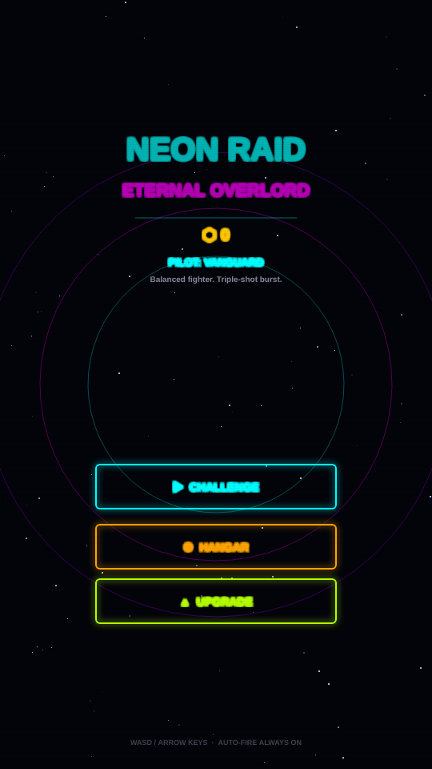 | 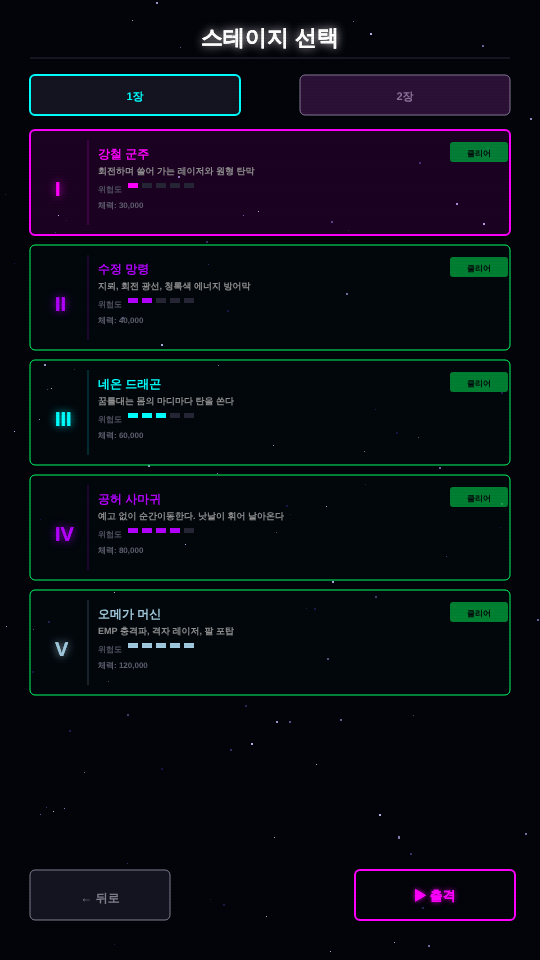 | 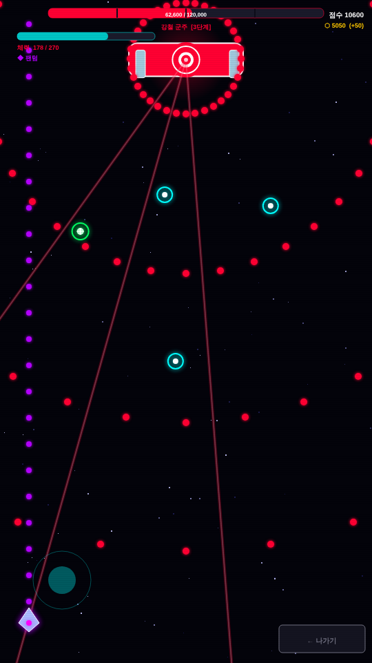 | 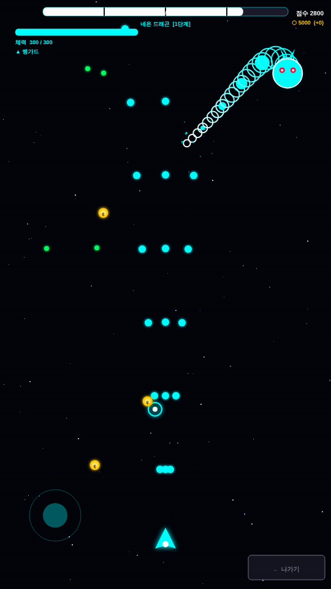 | 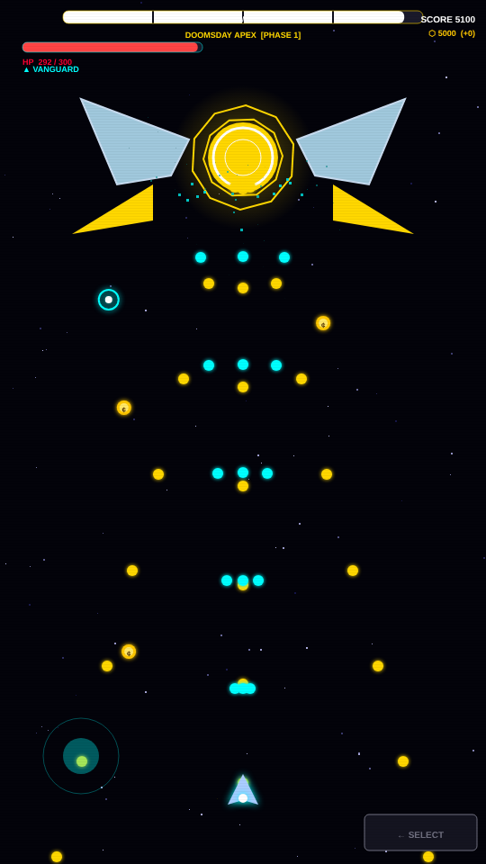 |

### 하는 법

[`dist/neon-raid.html`](dist/neon-raid.html) 파일 하나를 브라우저로 여세요. (저장소를 받았다면 `neon-raid/index.html`)

| 동작 | 키보드 · 마우스 | 휴대폰 |
|---|---|---|
| 이동 | 방향키 / WASD | 왼쪽 아래 가상 조이스틱을 끌기 |
| 공격 | 자동 발사 | 자동 발사 |
| 메뉴 | 버튼 클릭 | 버튼 터치 |
| 전투 중 나가기 | 오른쪽 아래 `← 나가기` | 같음 |

- 화면에 떠다니는 **청록 구슬**을 먹으면 잠깐 무적이 되고 보스에게 탄 5발을 날립니다. **초록 구슬**은 체력 +50, **노란 코인**은 코인 +10.
- 1장(보스 1~5)을 모두 깨면 2장(보스 6~10)이 열립니다. 진행 · 코인 · 기체 · 강화는 브라우저에 자동 저장됩니다.

### 보스 10명

| | 보스 (원래 이름) | 체력 | 특징 |
|---|---|---|---|
| I | 강철 군주 (STEEL OVERLORD) | 30,000 | 조준 레이저와 원형 탄막, 4단계에 쓸어 가는 레이저 |
| II | 수정 망령 (CRYSTAL PHANTOM) | 40,000 | 지뢰, 회전 광선, 켜졌다 꺼지는 방어막 |
| III | 네온 드래곤 (NEON DRAGON) | 60,000 | 꿈틀대는 몸 마디마다 탄, 머리에서 레이저 |
| IV | 공허 사마귀 (VOID MANTIS) | 80,000 | 순간이동, 휘어 날아오는 낫 |
| V | 오메가 머신 (OMEGA MACHINE) | 120,000 | EMP 충격파, 팔 레이저, 유도 미사일 |
| VI | 철의 수호자 (IRON GUARDIAN) | 150,000 | 과충전 레이저, 지진 고리, 파편 미사일 |
| VII | 쌍둥이 요격기 (TWIN INTERCEPTORS) | 180,000 | 레이저로 이어진 두 대, 체력 절반에서 한 대가 터지고 남은 한 대가 폭주 |
| VIII | 환영 군주 (PHANTOM LORD) | 220,000 | 분신 4개 중 진짜만 맞음, 중력 왜곡 |
| IX | 심연의 포식자 (ABYSSAL PREDATOR) | 260,000 | 잠수했다가 소나로 위치를 잡고 돌진, 십자 레이저 물 지뢰 |
| X | 종말의 정점 (DOOMSDAY APEX) | 380,000 | 3단계부터 블랙홀이 끌어당기고 제한 시간 |

기체 5종(뱅가드 · 팬텀 · 타이탄 · 스펙터 · 노바)과 강화 6종(이동 속도 · 최대 체력 · 공격력 · 연사 속도 · 자동 회복 · 코인 자석)이 있습니다.

### 원본에서 바꾼 점

**글자를 한국어로**: 메뉴, 보스·기체·강화 이름과 설명, 전투 화면, 승리 화면의 글자를 모두 한국어로 바꿨습니다.
한글이 작은 글씨에서도 읽히도록 네온 빛 효과를 글자를 겹쳐 찍는 방식에서 그림자 번짐으로 바꿨고, 전투 화면 왼쪽 위의 기체 이름을 체력 글자와 겹치지 않게 조금 내렸습니다.

**레이저가 자연스럽게 나가도록**:

| 문제 (원본) | 고친 뒤 |
|---|---|
| 1번 쓸어 가는 레이저 · 5번 팔 레이저 · 10번 블랙홀 레이저가 화면 중간에서 끊겨 보이고, 보이지 않는 곳에서도 맞음 (그림 700px, 판정 1200px) | 판정과 같은 길이로 화면 끝까지 그림 |
| 레이저가 쏜 자리에 남아서, 움직이는 보스(특히 3번 드래곤 머리)와 떨어져 허공에서 나옴 | 보스가 쏜 레이저는 보스에 붙어서 같이 움직임 |
| 7번 보스가 폭주하면 보이지 않는 기체에 레이저가 계속 이어지고, 보이는 기체는 쏴도 안 맞음 | 체력 절반에서 두 번째 기체가 터지며 연결 레이저가 끊김. 남은 기체(맞는 쪽)가 두 발씩 쏴서 탄 수는 그대로 |
| 9번 물 지뢰는 십자 모양인데 레이저가 오른쪽·아래로만 나감 | 십자 네 방향으로 나감 |
| 5번 팔 레이저 · 2번 회전 광선이 예고 없이 갑자기 나타남 | 조준선이 점점 밝아지는 충전을 보여 준 뒤 켜짐 |
| 1번 4단계 · 10번 3~4단계의 레이저가 단계가 바뀌자마자 맞음 | 1초 동안 조준선으로 예열한 뒤 맞기 시작함 |
| 조준 레이저의 예고선이 너무 흐려 잘 안 보임 | 쏘는 곳에 빛이 모이고 조준선이 점점 밝고 굵어짐 |

그 밖의 규칙(보스 패턴, 탄, 체력, 상점 가격)은 원본과 같습니다.

### 원본과 같은지 어떻게 확인했나 (한국어로 바꾸기 전)

- **코드**: 원본 `src/game/engine.ts` · `constants.ts` 에서 TypeScript 타입 표기만 지우고 줄 배치는 그대로 두었습니다. 두 쪽을 TypeScript 로 정규화해 비교하면 한 줄도 다르지 않았습니다.
- **화면**: 원본(Replit)과 이 저장소 버전을 같은 난수 · 같은 입력(클릭 · 키보드)으로 돌려 37장을 찍어 픽셀 단위로 비교했고, 모두 차이 0 이었습니다 (메뉴 전부, 보스 10명, 기체 5종으로 긴 전투).
- 원본의 React · Vite 껍데기는 빼고, 같은 화면 구성(가운데 정렬한 540×960 캔버스)을 HTML/CSS 로 만들었습니다.
- 그 뒤에 위의 "원본에서 바꾼 점"만 손봤고, 바꾼 곳마다 코드에 원본이 어땠는지 주석으로 남겼습니다.

### 구조

```
neon-raid/
  index.html        캔버스 하나 (원본 NeonRaid.tsx 의 화면 구성)
  css/style.css     원본 index.css + 인라인 스타일
  js/constants.js   색 · 글꼴 · 보스 · 기체 · 강화 · 스테이지 색 (원본 constants.ts)
  js/engine.js      게임 전부: 메뉴 · 보스 10명 패턴 · 그리기 (원본 engine.ts)
  js/main.js        엔진을 캔버스에 붙여 시작
```

---

# 하늘 사냥꾼 (Sky Hunter)

작은 전투기를 몰고 기계 요새 안으로 들어가, 거대한 기계 보스 **「강철 요새 타이탄」** 과 일대일로 싸우는 **픽셀 아트 슈팅 게임**입니다.
PC 에서 편하도록 **가로 화면(16:9)** 이고, 보스는 위에 있고 내 비행기는 아래에서 위로 쏩니다.
타이틀·메뉴·점수판까지 모두 게임 화면 안에 한국어 픽셀 글자로 그려집니다.

| 타이틀 | 1단계: 벽에서 나온 레이저포 |
|---|---|
| 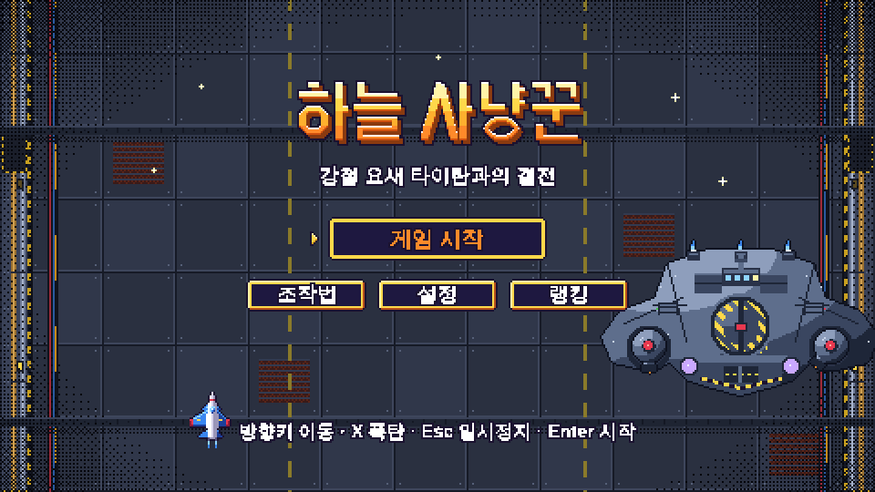 | 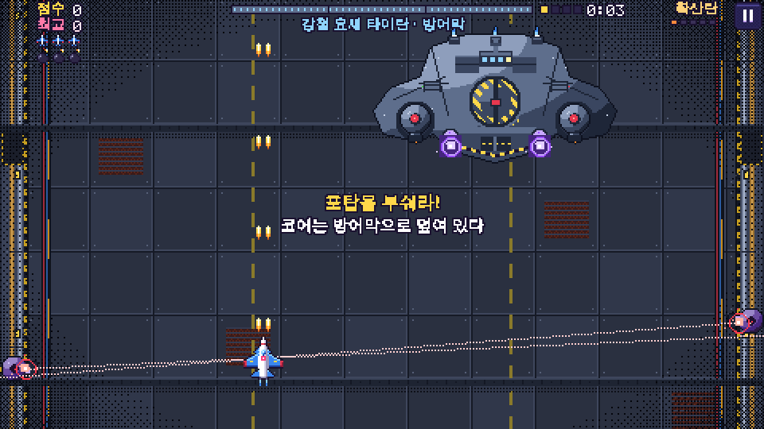 |
| **2단계: 주포 개방 · 조준하고 충전** | **4단계: 폭주 · 레이저 감옥** |
| 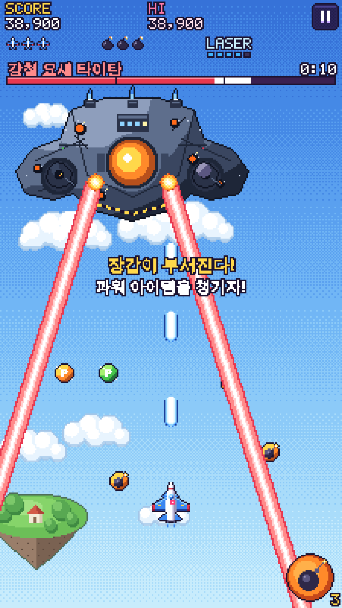 | 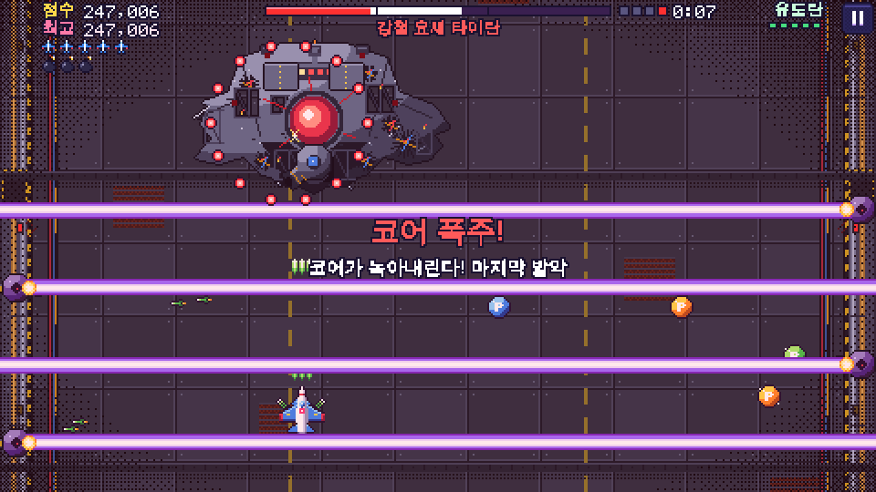 |

### 하는 법

[`dist/sky-hunter.html`](dist/sky-hunter.html) 파일 하나를 브라우저로 여세요. (저장소를 받았다면 `shooter/index.html`)

| 동작 | 키보드 | 휴대폰 |
|---|---|---|
| 이동 | 방향키 / WASD (`Shift` 누르면 천천히) | 화면을 끌기 |
| 공격 | 자동 발사 | 자동 발사 |
| 폭탄 | `X` / `Space` | 오른쪽 아래 버튼, 또는 두 번째 손가락으로 톡 |
| 일시정지 · 메뉴 | `Esc` / `P` · 메뉴는 방향키 + `Enter` | 오른쪽 위 버튼 |

비행기는 키보드로 움직입니다 (마우스로는 움직이지 않습니다). 비행기 **가운데 빨간 점**에만 맞지 않으면 됩니다.

### 보스는 이렇게 공격합니다

모든 공격은 **보스 몸에 달린 무기**나 **보스가 불러낸 벽 레이저포**에서 나옵니다. 총을 쏘듯 언제나 같은 순서입니다.

1. **조준** — 포신이 나를 향해 돌아가고, 겨눈 방향으로 **빨간 점선(조준선)** 이 보입니다.
2. **충전** — 총구로 빛 알갱이가 빨려 들며 빛이 커집니다. (점선이 촘촘해지고 깜빡이면 곧 발사)
3. **발사** — 그 무기의 **총구에서** 탄·레이저가 나갑니다. 레이저는 총구를 따라 움직입니다.

**벽 레이저포**: 보스 머리 위 신호기가 깜빡이며 부르면, 양쪽 벽(과 아래 구석)에서 레이저포가 레일을 타고 **스윽 나와** 조준 → 충전 → 발사하고 다시 **스윽 들어갑니다**. 나와 있는 동안 쏴서 부술 수 있습니다.

패턴은 17가지입니다. 단계마다 쓸 수 있는 패턴 묶음에서 무작위로 고르되 **바로 전 두 패턴은 다시 고르지 않아서**, "딸기 · 블루베리 · 딸기 · 블루베리" 처럼 똑같이 되풀이되지 않습니다. 몇몇 패턴은 둘이 동시에 나옵니다 (주포 + 벽 레이저포 등).

### 4단계 — 점점 부서지는 보스

단계가 넘어갈 때마다 폭발과 함께 보스의 **모습 자체가 바뀌고**(덮어씌우는 것이 아니라 다른 그림), 쓰던 무기가 부서져 그 패턴이 사라지며, **새 무기를 꺼내** 새 패턴이 열립니다.

| 단계 | 모습 | 쓰는 무기 | 대표 패턴 |
|---|---|---|---|
| 1 완전 무장 | 멀쩡한 요새, 코어는 방어막 | 양쪽 포탑 · 플라스마 발사구 · 배기구 · 벽 레이저포 | 포탑 3연사, 포신 휘두르기, 플라스마 구체, 벽 저격 |
| 2 장갑 붕괴 | 앞 장갑이 떨어져 나가 뼈대와 주포 칸이 드러남 | **주포 개방!** · 발사구 · 배기구 · 코어 | 추적 레이저, 벽 가로 레이저(위아래로 피하기), 십자 사격, 코어 고리탄 |
| 3 내부 노출 | 왼쪽 날개가 뜯기고 구멍·배관·불꽃, 등 격납고가 열림 | **미사일 포드 개방!** · 주포 · 코어 (발사구·배기구는 파괴) | 미사일 일제 사격(쏴서 격추), 부채꼴 쓸기, 구석 저격, 나선탄, 주포+벽 협공 |
| 4 폭주 | 판이 벗겨져 뼈대만 남고 코어가 붉게 녹아내림, 붉은 경광등 | **코어 폭주!** · 주포 · 포드 · 벽 레이저포 | 양방향 나선, 레이저 감옥(틈으로 들어가기), 2초 충전 거대 레이저 |

- 포탑을 부수거나 단계가 바뀔 때마다 **파워 아이템(P)** 이 나옵니다. 아이템 색이 몇 초마다 바뀌는데, 먹은 색의 무기로 바뀝니다.
  주황 = 확산탄, 파랑 = 관통 레이저, 초록 = 유도 미사일.
- 폭탄은 화면의 탄과 레이저를 모두 지우고 잠깐 무적이 됩니다. 목숨이 다하면 10초 안에 **이어하기**를 고를 수 있습니다.
- 깨면 다음 **회차**에 도전할 수 있습니다. 보스가 더 단단하고 빨라집니다. 최고 점수 5위까지 저장됩니다.

### 구조

```
shooter/index.html        진입점 (캔버스 하나)
shooter/js/util.js        공용 도우미 · 논리 화면 크기(960×540)
shooter/js/data.js        내 무기 · 보스(무기 위치 · 단계 · 패턴 묶음과 확률)
shooter/js/boss.js        보스 패턴: 조준 → 충전 → 발사를 차례로 하는 스크립트(제너레이터), 단계 변신
shooter/js/game.js        게임 엔진: 무기·벽 레이저포·레이저·탄·충돌 (DOM 없음, Node 에서 테스트)
shooter/js/pix.js         픽셀 그림 엔진 (글자 그림 / 코드 그림, 5×7 픽셀 글꼴, 한글 픽셀 글자)
shooter/js/sprites/       비행기·탄·아이템, 기계 보스(4가지 모습·포탑·주포·포드·벽 레이저포), 효과, 제목·버튼
shooter/js/render.js      480×270 픽셀 버퍼에 그린 뒤 번짐 없이 확대 (1080p 에서 꼭 4배)
shooter/js/ui.js          타이틀·조작법·설정·순위·일시정지·이어하기·결과·엔딩 (모두 캔버스 안)
shooter/js/fx.js · audio.js · input.js · main.js   효과 · 합성 소리 · 입력 · 루프
tools/sprite-sheet.js     그림 미리보기 PNG 만들기 (Playwright)
tests/shooter.test.js     규칙 검사 + 봇이 끝까지 플레이하는 시뮬레이션
```

그림을 고치거나 더할 때는 [`shooter/SPRITES.md`](shooter/SPRITES.md) 를 보고, 미리보기로 확인하세요.

```bash
node tools/sprite-sheet.js preview.png --only=titan,cannon
```

---

# 카드 원정대 (Deck Expedition)

브라우저에서 바로 즐기는 **로그라이크 덱빌딩 카드 배틀 게임**입니다.
덱을 쌓고, 갈림길을 고르고, 세 개의 막을 지나 심연의 끝에 있는 **태고의 용**을 쓰러뜨리세요.

설치도, 빌드도, 인터넷 연결도 필요 없습니다. 그림은 모두 코드로 그린 SVG이고, 효과음과 배경음악은 브라우저에서 실시간으로 합성합니다.

| 타이틀 | 지도 |
|---|---|
| 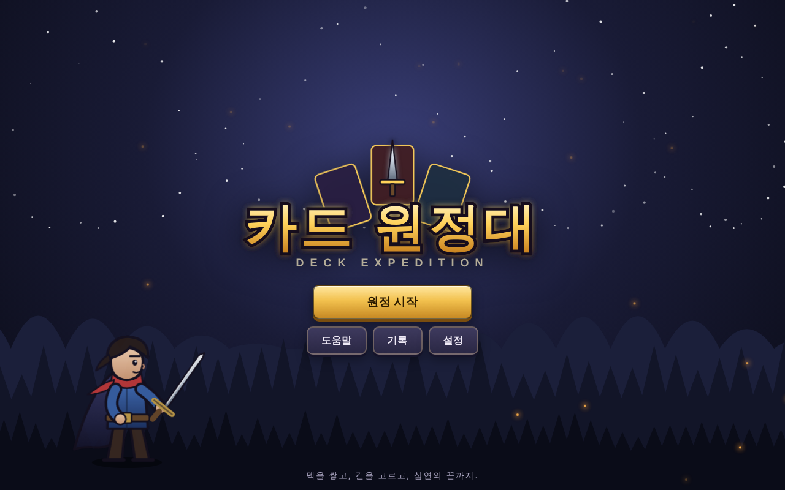 | 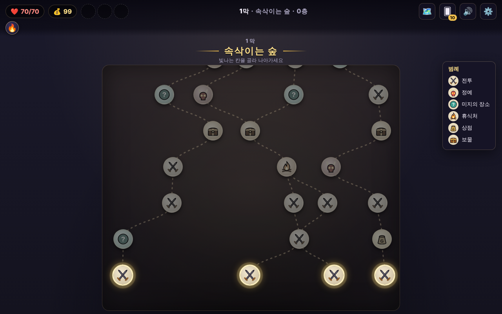 |
| **전투 (보스: 리치 왕)** | **이벤트** |
| 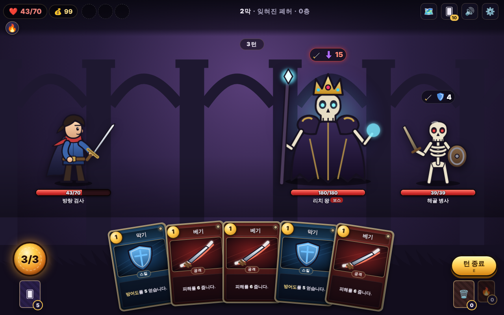 | 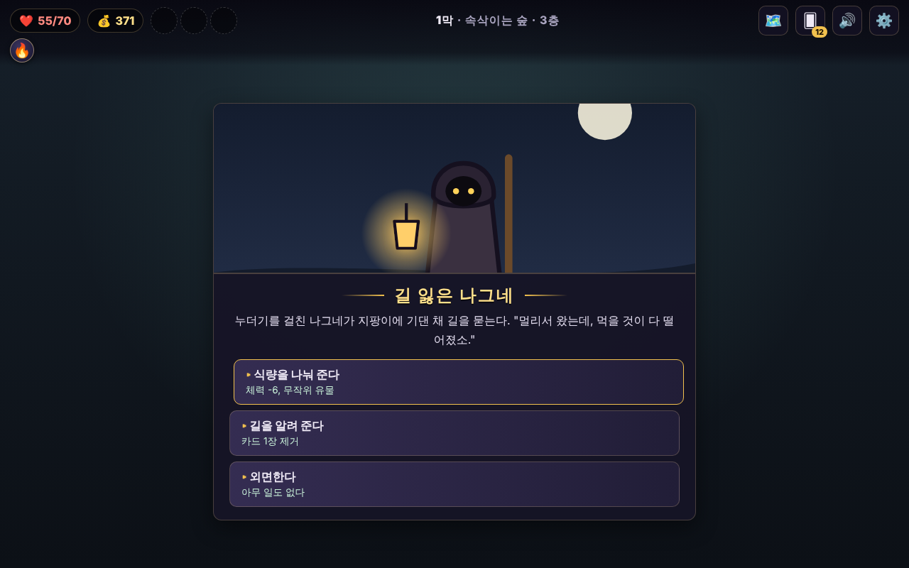 |

## 실행 방법

**가장 간단한 방법:** [`dist/card-expedition.html`](dist/card-expedition.html) 파일 하나만 내려받아 브라우저(Chrome, Edge, Firefox, Safari)로 여세요. 게임 전체가 이 파일 하나에 들어 있습니다.

저장소 전체를 받았다면 `index.html` 을 열어도 됩니다.

로컬 서버로 띄우고 싶다면:

```bash
python3 -m http.server 8000
```

그다음 브라우저에서 `http://localhost:8000` 을 엽니다.

## 플레이 방법

1. **지도**: 아래에서 위로 길을 골라 나아갑니다. 빛나는 칸만 고를 수 있습니다.
   - ⚔️ 전투 · 😈 정예(유물 보상) · ❓ 미지의 장소(이벤트) · 🔥 휴식처 · 💰 상점 · 🎁 보물 상자 · 👑 보스
2. **전투**: 매 턴 에너지 3을 얻고 카드 5장을 뽑습니다.
   - 카드를 **위로 끌어 올리면** 사용됩니다. 공격 카드는 **적에게 끌어다 놓아** 대상을 고릅니다.
   - 적 머리 위 아이콘은 **다음 행동**입니다. 큰 공격이 예고되면 방어도로 대비하세요.
   - 턴이 끝나면 남은 손패는 버려지고, 방어도는 다음 내 턴이 시작될 때 사라집니다.
3. **성장**: 승리하면 골드·카드·물약을 얻고, 정예와 보스는 유물을 줍니다.
   휴식처에서 카드를 **강화**하고, 상점에서 필요 없는 카드를 **제거**해 덱을 날카롭게 다듬으세요.
4. 1막(속삭이는 숲) → 2막(잊혀진 폐허) → 3막(불타는 심연)의 보스를 모두 쓰러뜨리면 승리!

### 조작

| 입력 | 동작 |
|---|---|
| 카드 끌어 올리기 / 클릭 | 카드 선택·사용 |
| 카드를 적에게 끌어다 놓기 | 대상 지정해서 사용 |
| `1`~`9` | 손패 카드 선택 |
| `←` `→` / `Tab` | 대상 변경 |
| `Enter` / `Space` | 선택한 카드 사용 |
| `E` | 턴 종료 |
| `Esc` / 오른쪽 클릭 | 취소 |
| 물약 아이콘 클릭 | 물약 사용 (전투 중) |

진행 상황은 자동으로 저장되며, 타이틀 화면의 **이어하기**로 이어서 할 수 있습니다.

## 주요 특징

- **카드 50여 장**: 힘/큰 한 방, 방어/요새, 독, 연타(이번 턴 사용한 카드 수), 소멸 시너지, 드로우/에너지 등 여러 빌드
- **적 22종**: 막마다 다른 적, 정예, 그리고 체력이 절반이 되면 **2페이즈**에 돌입하는 보스 3종 (리치 왕은 해골을 소환)
- **유물 29종, 물약 14종, 이벤트 12개**
- 상태이상 19종: 힘, 민첩, 약화, 취약, 허약, 독, 재생, 가시, 철갑, 투지, 요새, 결계 등 (마우스를 올리면 설명이 나옵니다)
- 분기형 지도를 매번 새로 생성 (시드 기반)
- 파티클·베기 궤적·화면 흔들림·떠오르는 숫자·배너 등 타격감 있는 연출
- 화면별 배경음악과 효과음 (설정에서 음량 조절, 빠른 연출, 화면 흔들림 끄기)
- 데스크톱과 휴대폰 화면 모두 지원

## 프로젝트 구조

```
index.html          진입점 (스크립트 로드 순서가 중요합니다)
css/                화면별 스타일 (base, cards, screens, battle, fx, art)
js/util.js          공용 도우미 (시드 난수, 한국어 조사 처리 등)
js/data/            게임 데이터 — 카드, 적, 유물, 물약, 이벤트, 키워드
js/core/            순수 게임 로직 (DOM 없음) — 전투 엔진, 런 진행, 저장
js/art/             SVG 아트 생성기 (적, 주인공, 아이콘, 배경, 로고)
js/fx/              시각 효과(캔버스 파티클)와 사운드(WebAudio 합성)
js/ui/              화면 — 공용 UI, 지도, 각종 화면 흐름, 전투 화면
js/main.js          시작점
tools/build.js      한 파일짜리 게임(dist/card-expedition.html) 만들기
dist/               한 파일짜리 게임 (배포용)
tests/              Node 로 돌리는 엔진 테스트와 전체 런 시뮬레이터
docs/ARCHITECTURE.md  모듈 간 계약(API, 데이터 형식, 이벤트 타입)
```

## 콘텐츠 추가하기

데이터 파일만 고치면 새 카드·적·유물을 넣을 수 있습니다. 카드 설명 문구는 효과를 보고 **자동으로 만들어집니다.**

### 카드 (`js/data/cards.js`)

```js
fireSlash: {
  name: '화염 베기', type: 'attack', rarity: 'uncommon', cost: 1, target: 'enemy', art: 'fire',
  effects: [{ type: 'damage', value: 8 }, { type: 'applyStatus', status: 'vulnerable', value: 1, target: 'enemy' }],
  upgrade: { effects: [{ type: 'damage', value: 11 }, { type: 'applyStatus', status: 'vulnerable', value: 2, target: 'enemy' }] },
},
```

- `type`: `attack` / `skill` / `power` · `rarity`: `common` / `uncommon` / `rare`
- `target`: `enemy`(대상 선택) / `allEnemies` / `self`
- 키워드: `exhaust`(소멸), `retain`(보존), `ethereal`(휘발), `innate`(선천)
- `art`: 카드 그림 아이콘 이름 (`slash`, `shield`, `fire`, `poison` … — `docs/ARCHITECTURE.md` §5.2)

### 효과 종류

| 효과 | 설명 |
|---|---|
| `damage` | 피해 (`value`, `times`, `target`, `lifesteal`, `bonusPer`) |
| `block` | 방어도 획득 |
| `applyStatus` | 상태이상 부여 (`status`, `value`, `target`) |
| `heal` / `healPct` / `loseHp` | 회복 / 최대 체력 비율 회복 / 체력 잃기 |
| `draw` / `energy` | 카드 뽑기 / 에너지 획득 |
| `multiplyStatus` / `multiplyBlock` | 상태이상·방어도 배수 |
| `addCard` | 카드를 손/더미에 추가 (적이 상처·화상을 넣을 때도 사용) |
| `summon` | 적 소환 (적 전용) |

전체 목록과 규칙은 `docs/ARCHITECTURE.md` 를 참고하세요.

### 적 (`js/data/enemies.js`)

기술(`moves`)과 행동 패턴(`pattern`: 순서대로 `cycle` 또는 가중치 `random`)을 정하고, `CB.data.encounters` 에 조우 그룹으로 등록합니다. 새 적의 그림은 `js/art/enemies.js` 에 추가합니다(없으면 기본 실루엣이 나옵니다).

### 유물·물약·이벤트

- 유물(`js/data/relics.js`): `triggers`(전투 시작, 턴 시작, 카드 사용 시 등)와 `modifiers`(에너지 +1, 상점 할인 등)로 정의
- 물약(`js/data/potions.js`): 전투 중 한 번 쓰는 효과
- 이벤트(`js/data/events.js`): 장면 그림, 본문, 선택지와 결과(확률 분기 가능)

## 한 파일로 만들기

코드를 고친 뒤 아래 명령을 실행하면 모든 CSS/JS 를 합친 `dist/card-expedition.html` · `dist/sky-hunter.html` · `dist/neon-raid.html` 이 다시 만들어집니다.

```bash
node tools/build.js
```

## 테스트

```bash
node tests/engine.test.js
```

```bash
node tests/shooter.test.js
```

```bash
node tests/neon-raid.test.js
```

```bash
node tests/sim.js --runs 300 --seed 1
```

- `engine.test.js`: 데이터 참조 검사와 전투 규칙(피해 공식, 상태이상 타이밍, 결계, 가시, 2페이즈, 소환 상한, 저장 등) 검사
- `sim.js`: 간단한 봇이 수백 판을 자동으로 플레이하며 오류·무한 전투를 찾고 승률과 사망 원인을 집계합니다. 밸런스를 바꿀 때 참고하세요.

브라우저에서 `index.html?debug` 로 열면 콘솔에서 `CB.debug.win()`, `CB.debug.gold(500)`, `CB.debug.act(3)`, `CB.debug.node('shop')` 같은 테스트용 명령을 쓸 수 있습니다.
