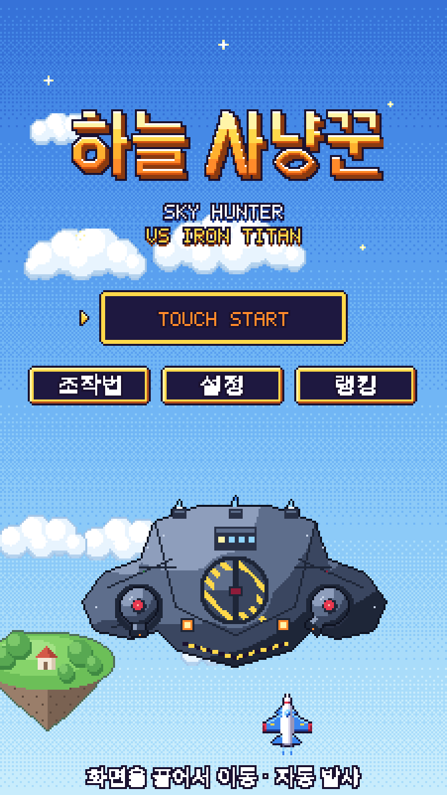
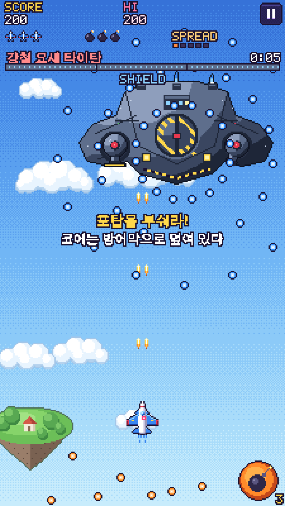
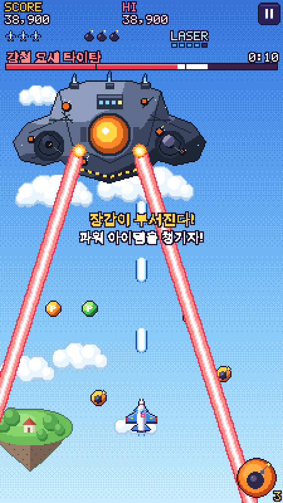
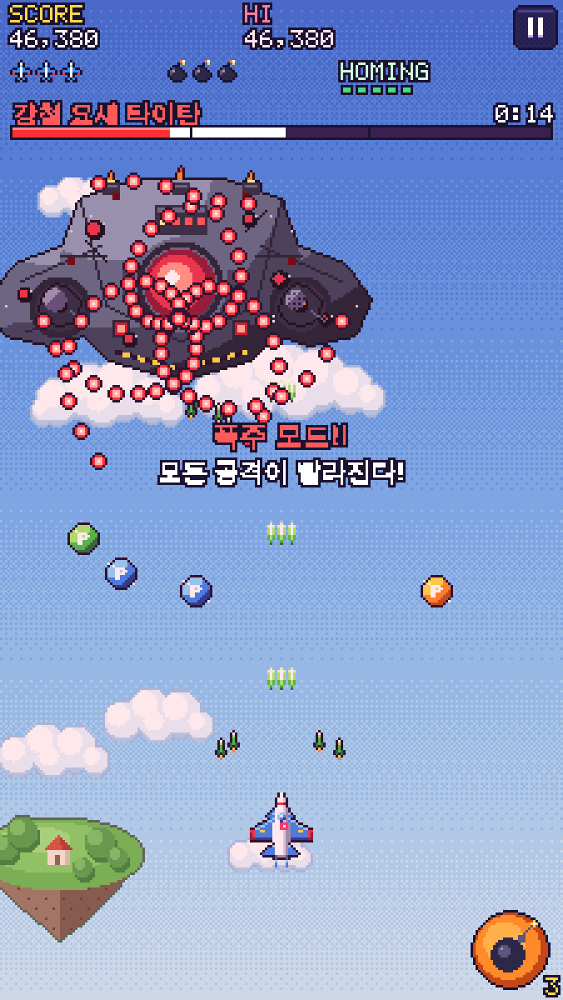
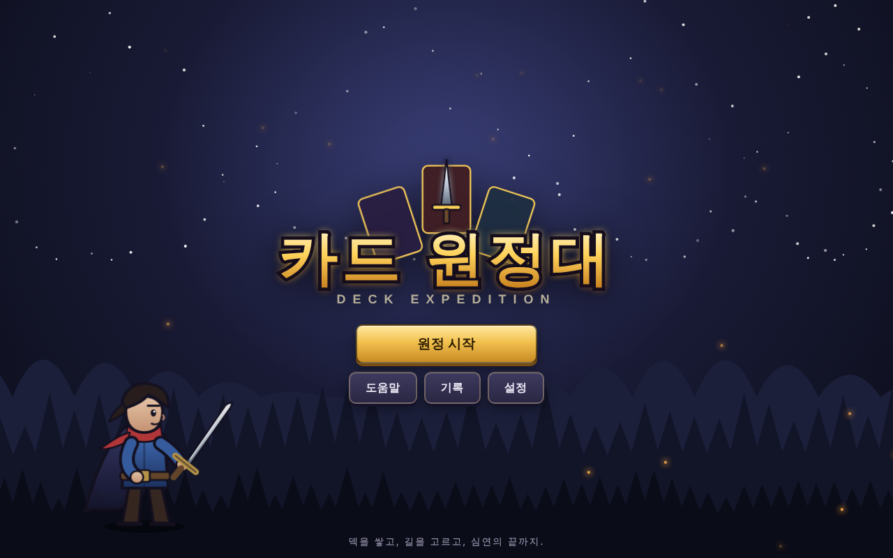
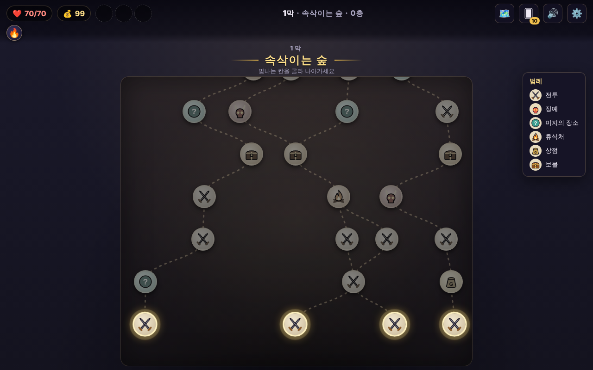
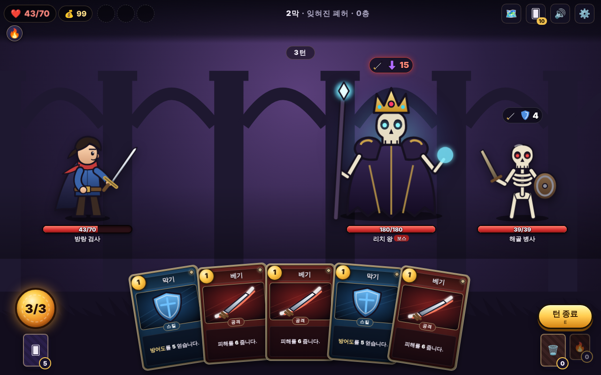
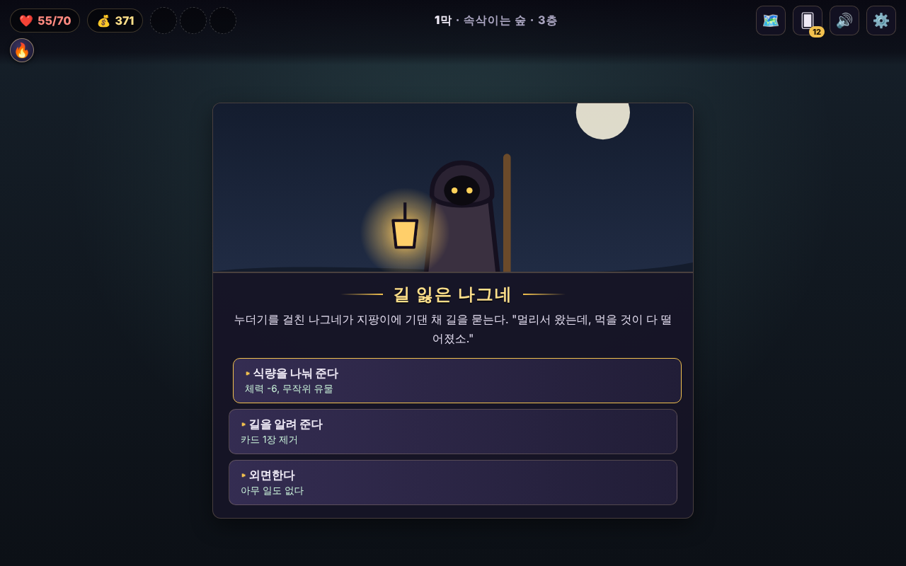

# 게임 모음

이 저장소에는 설치 없이 브라우저에서 바로 하는 게임 두 개가 들어 있습니다.

| 게임 | 장르 | 바로 하기 (파일 하나) |
|---|---|---|
| 🛩️ **하늘 사냥꾼** | 픽셀 아트 종스크롤 슈팅 · 기계 보스 결전 | [`dist/sky-hunter.html`](dist/sky-hunter.html) |
| 🃏 **카드 원정대** | 로그라이크 덱빌딩 카드 배틀 | [`dist/card-expedition.html`](dist/card-expedition.html) |

---

# 하늘 사냥꾼 (Sky Hunter)

작은 전투기를 몰고 하늘을 뒤덮은 거대한 기계 요새 **「강철 요새 타이탄」** 과 일대일로 싸우는 **픽셀 아트 슈팅 게임**입니다.
타이틀·메뉴·점수판까지 모두 게임 화면 안에 픽셀로 그려지고, 휴대폰에서는 화면을 끌기만 하면 됩니다.

| 타이틀 | 1단계: 포탑 파괴 | 3단계: 쌍둥이 레이저 | 4단계: 폭주 모드 |
|---|---|---|---|
|  |  |  |  |

### 하는 법

[`dist/sky-hunter.html`](dist/sky-hunter.html) 파일 하나를 브라우저로 여세요. (저장소를 받았다면 `shooter/index.html`)

| | 휴대폰 | PC |
|---|---|---|
| 이동 | 화면 아무 데나 대고 끌기 (손가락에 비행기가 안 가려짐) | 방향키 / WASD, `Shift` 천천히 |
| 공격 | 자동 발사 | 자동 발사 |
| 폭탄 | 오른쪽 아래 폭탄 버튼, 또는 끄는 중에 두 번째 손가락으로 톡 | `X` / `Space` |
| 일시정지 | 오른쪽 위 버튼 | `Esc` / `P` |

- 비행기 **가운데 빨간 점**에만 맞지 않으면 됩니다.
- **1단계** 코어가 방어막으로 덮여 있어요. 양쪽 **포탑**부터 부수세요.
- **2~3단계** 코어가 열리면 진짜 싸움. 빨간 점선은 **레이저가 지나갈 자리**입니다. 미리 피하세요.
  빨간 **미사일**은 총으로 쏴서 터뜨릴 수 있습니다.
- **4단계 폭주 모드** — 경보가 울리고 모든 공격이 빨라집니다.
- 포탑을 부수거나 단계가 바뀔 때마다 **파워 아이템(P)** 이 나옵니다. 아이템 색이 몇 초마다 바뀌는데, 먹은 색의 무기로 바뀝니다.
  주황 = 확산탄, 파랑 = 관통 레이저, 초록 = 유도 미사일. 화면 위쪽으로 가면 아이템이 모두 빨려 옵니다.
- 폭탄은 화면의 탄을 모두 지우고 잠깐 무적이 됩니다. 목숨이 다하면 10초 안에 **이어하기**를 고를 수 있습니다.
- 깨면 다음 **회차(LOOP)** 에 도전할 수 있습니다. 보스가 더 단단하고 빨라집니다. 최고 점수 5위까지 저장됩니다.

### 구조

```
shooter/index.html        진입점 (캔버스 하나)
shooter/js/util.js        공용 도우미 · 논리 화면 크기(450×800)
shooter/js/data.js        무기 · 보스(부품 · 단계 · 공격 패턴) — 숫자만 고쳐도 밸런스 조절
shooter/js/game.js        게임 엔진 (DOM 없음, Node 에서 테스트)
shooter/js/pix.js         픽셀 그림 엔진 (글자 그림 / 코드 그림, 5×7 픽셀 글꼴)
shooter/js/sprites/       비행기·탄·아이템, 기계 보스, 효과·배경, 제목·버튼 그림
shooter/js/render.js      225×400 픽셀 버퍼에 그린 뒤 번짐 없이 확대
shooter/js/ui.js          타이틀·메뉴·이어하기·결과 화면 (모두 캔버스 안)
shooter/js/fx.js · audio.js · input.js · main.js   효과 · 합성 소리 · 입력 · 루프
tools/sprite-sheet.js     그림 미리보기 PNG 만들기 (Playwright)
tests/shooter.test.js     규칙 검사 + 봇이 끝까지 플레이하는 시뮬레이션
```

그림을 고치거나 더할 때는 [`shooter/SPRITES.md`](shooter/SPRITES.md) 를 보고, 미리보기로 확인하세요.

```bash
node tools/sprite-sheet.js preview.png --only=titan,turret
```

---

# 카드 원정대 (Deck Expedition)

브라우저에서 바로 즐기는 **로그라이크 덱빌딩 카드 배틀 게임**입니다.
덱을 쌓고, 갈림길을 고르고, 세 개의 막을 지나 심연의 끝에 있는 **태고의 용**을 쓰러뜨리세요.

설치도, 빌드도, 인터넷 연결도 필요 없습니다. 그림은 모두 코드로 그린 SVG이고, 효과음과 배경음악은 브라우저에서 실시간으로 합성합니다.

| 타이틀 | 지도 |
|---|---|
|  |  |
| **전투 (보스: 리치 왕)** | **이벤트** |
|  |  |

## 실행 방법

**가장 간단한 방법:** [`dist/card-expedition.html`](dist/card-expedition.html) 파일 하나만 내려받아 브라우저(Chrome, Edge, Firefox, Safari)로 여세요. 게임 전체가 이 파일 하나에 들어 있습니다.

저장소 전체를 받았다면 `index.html` 을 열어도 됩니다.

로컬 서버로 띄우고 싶다면:

```bash
python3 -m http.server 8000
```

그다음 브라우저에서 `http://localhost:8000` 을 엽니다.

## 플레이 방법

1. **지도**: 아래에서 위로 길을 골라 나아갑니다. 빛나는 칸만 고를 수 있습니다.
   - ⚔️ 전투 · 😈 정예(유물 보상) · ❓ 미지의 장소(이벤트) · 🔥 휴식처 · 💰 상점 · 🎁 보물 상자 · 👑 보스
2. **전투**: 매 턴 에너지 3을 얻고 카드 5장을 뽑습니다.
   - 카드를 **위로 끌어 올리면** 사용됩니다. 공격 카드는 **적에게 끌어다 놓아** 대상을 고릅니다.
   - 적 머리 위 아이콘은 **다음 행동**입니다. 큰 공격이 예고되면 방어도로 대비하세요.
   - 턴이 끝나면 남은 손패는 버려지고, 방어도는 다음 내 턴이 시작될 때 사라집니다.
3. **성장**: 승리하면 골드·카드·물약을 얻고, 정예와 보스는 유물을 줍니다.
   휴식처에서 카드를 **강화**하고, 상점에서 필요 없는 카드를 **제거**해 덱을 날카롭게 다듬으세요.
4. 1막(속삭이는 숲) → 2막(잊혀진 폐허) → 3막(불타는 심연)의 보스를 모두 쓰러뜨리면 승리!

### 조작

| 입력 | 동작 |
|---|---|
| 카드 끌어 올리기 / 클릭 | 카드 선택·사용 |
| 카드를 적에게 끌어다 놓기 | 대상 지정해서 사용 |
| `1`~`9` | 손패 카드 선택 |
| `←` `→` / `Tab` | 대상 변경 |
| `Enter` / `Space` | 선택한 카드 사용 |
| `E` | 턴 종료 |
| `Esc` / 오른쪽 클릭 | 취소 |
| 물약 아이콘 클릭 | 물약 사용 (전투 중) |

진행 상황은 자동으로 저장되며, 타이틀 화면의 **이어하기**로 이어서 할 수 있습니다.

## 주요 특징

- **카드 50여 장**: 힘/큰 한 방, 방어/요새, 독, 연타(이번 턴 사용한 카드 수), 소멸 시너지, 드로우/에너지 등 여러 빌드
- **적 22종**: 막마다 다른 적, 정예, 그리고 체력이 절반이 되면 **2페이즈**에 돌입하는 보스 3종 (리치 왕은 해골을 소환)
- **유물 29종, 물약 14종, 이벤트 12개**
- 상태이상 19종: 힘, 민첩, 약화, 취약, 허약, 독, 재생, 가시, 철갑, 투지, 요새, 결계 등 (마우스를 올리면 설명이 나옵니다)
- 분기형 지도를 매번 새로 생성 (시드 기반)
- 파티클·베기 궤적·화면 흔들림·떠오르는 숫자·배너 등 타격감 있는 연출
- 화면별 배경음악과 효과음 (설정에서 음량 조절, 빠른 연출, 화면 흔들림 끄기)
- 데스크톱과 휴대폰 화면 모두 지원

## 프로젝트 구조

```
index.html          진입점 (스크립트 로드 순서가 중요합니다)
css/                화면별 스타일 (base, cards, screens, battle, fx, art)
js/util.js          공용 도우미 (시드 난수, 한국어 조사 처리 등)
js/data/            게임 데이터 — 카드, 적, 유물, 물약, 이벤트, 키워드
js/core/            순수 게임 로직 (DOM 없음) — 전투 엔진, 런 진행, 저장
js/art/             SVG 아트 생성기 (적, 주인공, 아이콘, 배경, 로고)
js/fx/              시각 효과(캔버스 파티클)와 사운드(WebAudio 합성)
js/ui/              화면 — 공용 UI, 지도, 각종 화면 흐름, 전투 화면
js/main.js          시작점
tools/build.js      한 파일짜리 게임(dist/card-expedition.html) 만들기
dist/               한 파일짜리 게임 (배포용)
tests/              Node 로 돌리는 엔진 테스트와 전체 런 시뮬레이터
docs/ARCHITECTURE.md  모듈 간 계약(API, 데이터 형식, 이벤트 타입)
```

## 콘텐츠 추가하기

데이터 파일만 고치면 새 카드·적·유물을 넣을 수 있습니다. 카드 설명 문구는 효과를 보고 **자동으로 만들어집니다.**

### 카드 (`js/data/cards.js`)

```js
fireSlash: {
  name: '화염 베기', type: 'attack', rarity: 'uncommon', cost: 1, target: 'enemy', art: 'fire',
  effects: [{ type: 'damage', value: 8 }, { type: 'applyStatus', status: 'vulnerable', value: 1, target: 'enemy' }],
  upgrade: { effects: [{ type: 'damage', value: 11 }, { type: 'applyStatus', status: 'vulnerable', value: 2, target: 'enemy' }] },
},
```

- `type`: `attack` / `skill` / `power` · `rarity`: `common` / `uncommon` / `rare`
- `target`: `enemy`(대상 선택) / `allEnemies` / `self`
- 키워드: `exhaust`(소멸), `retain`(보존), `ethereal`(휘발), `innate`(선천)
- `art`: 카드 그림 아이콘 이름 (`slash`, `shield`, `fire`, `poison` … — `docs/ARCHITECTURE.md` §5.2)

### 효과 종류

| 효과 | 설명 |
|---|---|
| `damage` | 피해 (`value`, `times`, `target`, `lifesteal`, `bonusPer`) |
| `block` | 방어도 획득 |
| `applyStatus` | 상태이상 부여 (`status`, `value`, `target`) |
| `heal` / `healPct` / `loseHp` | 회복 / 최대 체력 비율 회복 / 체력 잃기 |
| `draw` / `energy` | 카드 뽑기 / 에너지 획득 |
| `multiplyStatus` / `multiplyBlock` | 상태이상·방어도 배수 |
| `addCard` | 카드를 손/더미에 추가 (적이 상처·화상을 넣을 때도 사용) |
| `summon` | 적 소환 (적 전용) |

전체 목록과 규칙은 `docs/ARCHITECTURE.md` 를 참고하세요.

### 적 (`js/data/enemies.js`)

기술(`moves`)과 행동 패턴(`pattern`: 순서대로 `cycle` 또는 가중치 `random`)을 정하고, `CB.data.encounters` 에 조우 그룹으로 등록합니다. 새 적의 그림은 `js/art/enemies.js` 에 추가합니다(없으면 기본 실루엣이 나옵니다).

### 유물·물약·이벤트

- 유물(`js/data/relics.js`): `triggers`(전투 시작, 턴 시작, 카드 사용 시 등)와 `modifiers`(에너지 +1, 상점 할인 등)로 정의
- 물약(`js/data/potions.js`): 전투 중 한 번 쓰는 효과
- 이벤트(`js/data/events.js`): 장면 그림, 본문, 선택지와 결과(확률 분기 가능)

## 한 파일로 만들기

코드를 고친 뒤 아래 명령을 실행하면 모든 CSS/JS 를 합친 `dist/card-expedition.html` 과 `dist/sky-hunter.html` 이 다시 만들어집니다.

```bash
node tools/build.js
```

## 테스트

```bash
node tests/engine.test.js
```

```bash
node tests/shooter.test.js
```

```bash
node tests/sim.js --runs 300 --seed 1
```

- `engine.test.js`: 데이터 참조 검사와 전투 규칙(피해 공식, 상태이상 타이밍, 결계, 가시, 2페이즈, 소환 상한, 저장 등) 검사
- `sim.js`: 간단한 봇이 수백 판을 자동으로 플레이하며 오류·무한 전투를 찾고 승률과 사망 원인을 집계합니다. 밸런스를 바꿀 때 참고하세요.

브라우저에서 `index.html?debug` 로 열면 콘솔에서 `CB.debug.win()`, `CB.debug.gold(500)`, `CB.debug.act(3)`, `CB.debug.node('shop')` 같은 테스트용 명령을 쓸 수 있습니다.
