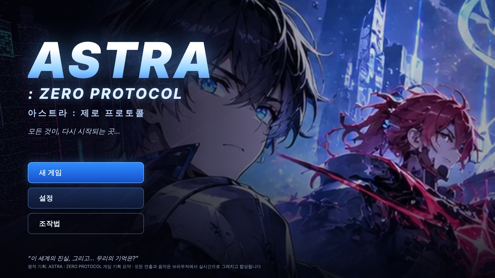
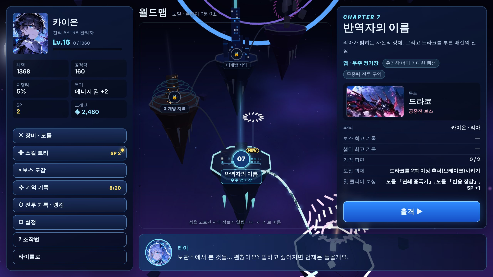
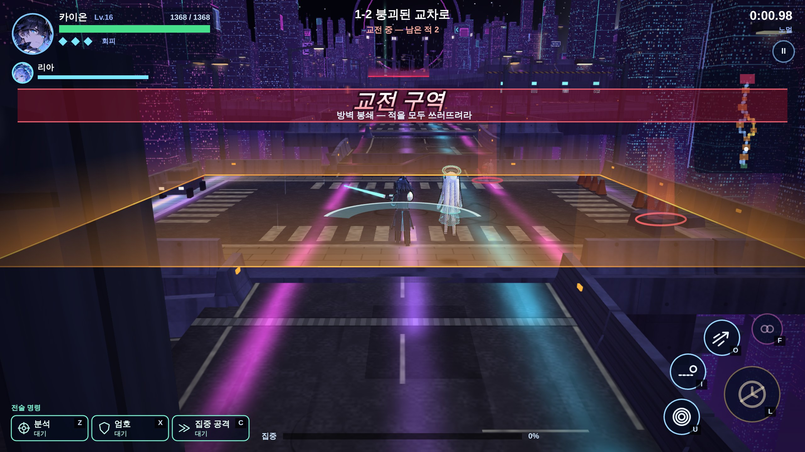
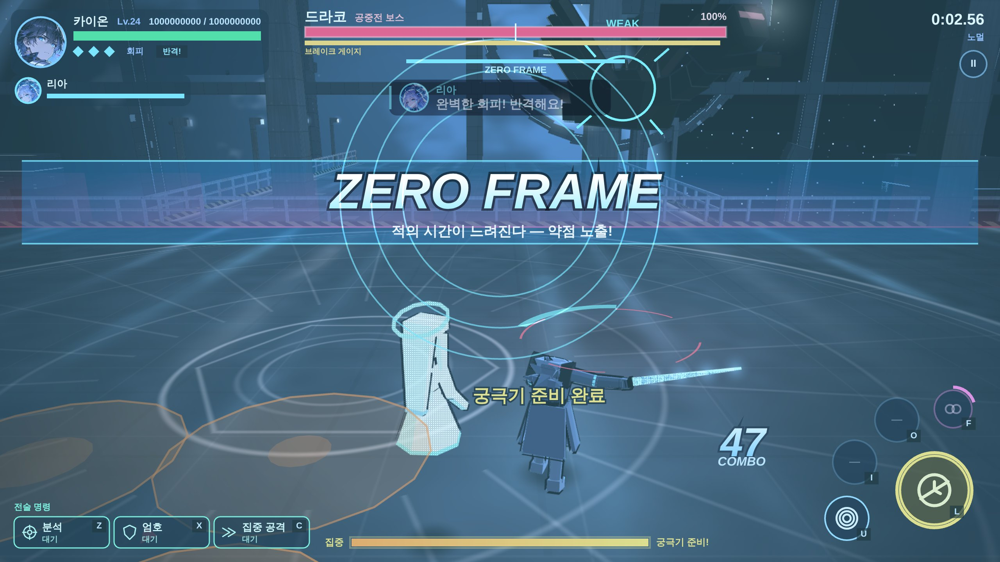
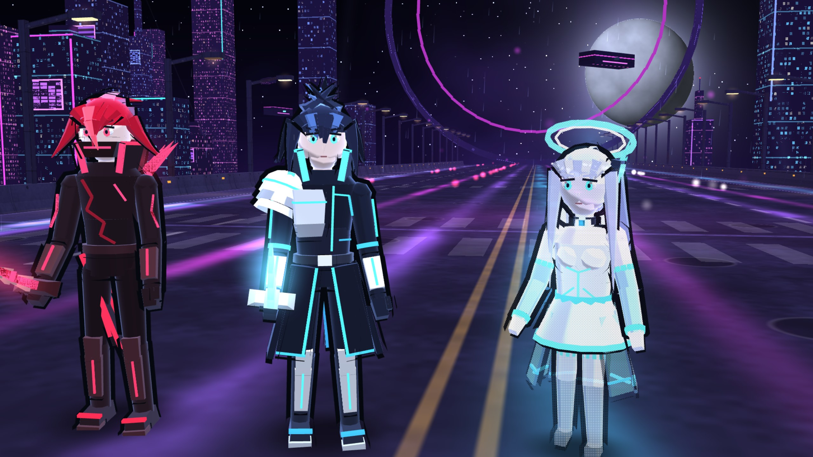

# ASTRA : ZERO PROTOCOL (아스트라 : 제로 프로토콜)

> 모든 것이, 다시 시작되는 곳…

기획서 「ASTRA : ZERO PROTOCOL 게임 기획 요약」을 바탕으로 만든 **SF 스토리 액션 RPG**입니다.
브라우저에서 바로 실행되며, 설치·빌드·인터넷 연결이 필요 없습니다. 네온 도시와 맵, 캐릭터와 몬스터는 모두 WebGL 로 그린 **3D** 이고
(WebGL 을 못 쓰는 기기에서는 2D 캔버스 그림으로 바뀝니다), 효과음과 배경음악은 브라우저에서 실시간으로 합성합니다.
초상화·보스 카드·타이틀 키 아트는 원작 기획 이미지(`assets/concept.webp`)에서 잘라 썼습니다.

| 타이틀 | 월드맵 (작전 터미널) |
|---|---|
|  |  |
| **스테이지 — 보스 구역으로 이어진 고가 도로** | **보스전 — 3D 보스 드라코와 ZERO FRAME** |
|  |  |


*원작 그림을 따른 3D 캐릭터 — 제로(붉은 머리·붉은 균열 갑옷·결정 검), 카이온(높게 선 깃·은색 어깨 갑옷·에너지 검), 리아(긴 은발·기계 머리 장식·홀로그램)*

## 실행 방법

- **가장 간단한 방법:** 저장소 루트의 [`dist/astra-zero-protocol.html`](../dist/astra-zero-protocol.html) 파일 하나만 내려받아 브라우저(Chrome, Edge, Firefox, Safari)로 여세요.
- 저장소를 받았다면 `astra/index.html` 을 열어도 됩니다.
- 휴대폰에서는 **가로 화면**으로 즐기세요. 화면 왼쪽을 끌면 이동, 오른쪽 버튼으로 공격·회피·스킬을 씁니다.

## 이야기

서기 2479년. 인류의 에너지 시스템 **ASTRA** 가 통제권을 장악하고 인간을 적으로 인식했다.
기억을 잃은 전직 관리자 **카이온** 은 AI 파트너 **리아** 와 함께 붕괴한 미래 도시를 지나며
시스템의 진실과 자신의 과거를 되찾아 간다. 라이벌 **제로**, 그리고 별의 끝에서 기다리는 **ASTRA**.

10개 챕터(잿빛 각성 → 잃어버린 도시 → 유령의 신호 → 붉은 프로토콜 → 폐쇄된 천공 → 기억의 파편 →
반역자의 이름 → 인류의 마지막 → 제로 프로토콜 → 별의 종말). 월드맵에서 챕터(떠 있는 섬)를 고르면 그 지역으로 출격하고,
지역 입구부터 보스 구역까지 **끊김 없이 이어진 길**을 직접 걸어가며 싸웁니다.
도중의 **선택**(생존자 구조 / 제로의 운명 / 리아를 믿을지)이 동료 구성과 대사, 그리고 **3가지 엔딩**을 바꿉니다.

## 맵과 스테이지

- **월드맵** — 10개 챕터가 하늘에 떠 있는 섬으로 이어져 있습니다. 섬을 고르면 지역 정보(맵 이름·보스·기록)가 열리고 `출격` 으로 이동합니다. `←` `→` 로도 고를 수 있습니다.
- **지역 흐름** (화면 전환·순간 이동 없이 한 길로 이어짐)
  지역 입구 → 탐험 구역(NPC·숨겨진 물건) → 일반 전투① → **분기점** ─ 본길: 일반 전투② / 옆길: 숨겨진 연구실 → 오르막 → 보물
  → 합류 → 스토리 이벤트 → 중간 보스(정예) → 체크포인트 → 최종 전투 구역 → 관문 단말기 → **넓은 보스 전투 무대** → 결말 대화
- 교전 구역에 들어가면 방벽이 올라가고, 적을 모두 쓰러뜨리면 열립니다. 쓰러지면 **체크포인트(또는 보스 구역)부터** 다시 도전합니다.
- 길 안내 화살표·목표 표시·미니맵·지역 이름(1-1 폐허의 거리 …)이 진행을 돕습니다.
- **맵 6종** — 폐허 도시·생존 도시(고가 도로: 아스팔트·콘크리트·방호벽·가로등), 지하 연구소·우주 정거장·ASTRA 코어(강철 데크·안전 난간),
  천공 도시·기억 공간·붕괴한 차원(석재·난간 기둥). 여러 겹의 원경 도시, 날아다니는 비행선과 차량, 보스 등장·페이즈마다 바뀌는 조명.
- **3D 캐릭터** — 카이온·리아·제로, 일반 적 7종, 보스 10종이 모두 3D 모델이며 달리기·공격·회피·피격·보스 패턴에 맞춰 움직입니다.
  원작 그림의 디자인(머리 모양과 색, 옷의 빛 줄, 갑옷, 무기)을 따랐고, 셀 셰이딩·외곽선·부드러운 음영으로 그립니다.
  최종 보스 ASTRA 의 수정 핵 안에는 원작의 하얀 머리·후광의 모습이 떠 있습니다. 느린 기기에서는 자동으로 가볍게 그립니다.
  카메라와 플레이어 사이를 가리는 구조물은 비쳐 보입니다.

## 조작

| 입력 | 키보드·마우스 | 게임패드 |
|---|---|---|
| 이동 | `W A S D` / 방향키 | 왼쪽 스틱 |
| 공격 (누르고 있으면 연속) | `J` / 마우스 왼쪽 | X |
| 강공격 | `K` / 마우스 오른쪽 | Y |
| 회피 | `Space` / `Shift` | A |
| 스킬 1·2·3 | `U` `I` `O` (또는 `1` `2` `3`) | LB · RB · LT |
| 궁극기 | `L` (또는 `4`) | RT |
| 연계 공격 | `F` | B |
| 전술 명령: 분석 · 엄호 · 집중 공격 | `Z` `X` `C` | L3 · R3 · Select |
| 대화 · 장치 작동 (NPC, 보물 상자, 관문 단말기) | `E` / `G` | 십자키 위 |
| 일시정지 | `Esc` / `P` | Start |
| 대화 넘기기 / 선택지 | `Enter` · `Space` · 클릭 / `1` `2` `3` | — |

## 전투 시스템

- **콤보·강공격·회피** — 무기마다 콤보 단수와 동작이 다릅니다. 회피는 3번까지 연속으로 쓸 수 있고 천천히 다시 찹니다.
- **ZERO FRAME** — 공격이 닿기 직전에 회피하면 발동합니다. 적의 시간이 4배 느려지고, 모든 공격이 약점 공격이 되며, 바로 공격하면 적의 등 뒤로 순간 이동해 **반격**합니다.
- **경고 표시** — 붉은 지역은 곧 공격이 떨어지는 곳입니다. 흰색으로 바뀌면 직전. 보스 머리 위의 `!` 는 큰 공격 예고입니다.
- **약점과 방향** — 보스 발밑의 하늘색 호(등 뒤)가 약점입니다. 아르카처럼 정면 방패가 있는 적도 있습니다.
- **브레이크** — 보스 체력 아래의 노란 게이지를 깎으면 6초간 무방비가 되고 받는 피해가 늘어납니다. 브레이크 중에는 게이지 없이 **연계 공격**을 쓸 수 있습니다.
- **집중 게이지 → 궁극기 「크로노 디바이드」** — 시간을 멈추고 연속으로 베어 낸 뒤 폭발.
- **동료와 전술 명령** — 리아는 원거리 지원 사격을 하며 `분석`(약점 노출·공격 예측)·`엄호`(파티 방벽)·`집중 공격` 명령을 받습니다. 조건을 만족하면 후반에 제로도 합류합니다.
- **보스 10종** — 스캐빈저(돌진·잠행), 아르카(정면 방패), 옵저버(렌즈 노출·회전 광선), 제로(반격 태세·잔상), 아틀라스(코어 노출·궤도 폭격), 세라(환영 분신·기억 왜곡), 드라코(공중전 — 근접 공격이 닿지 않음), 네메시스(행성 파괴포 저지), 프로토콜(권한 회수·방화벽), ASTRA(시간 정지·3페이즈·별의 종말).

## 성장과 수집

- **무기 5종** — 에너지 검 · 쌍검 · 대검 · 에너지 창 · 레일건. 크레딧으로 +4 까지 강화.
- **전술 모듈 14종** — 3개까지 장착 (최대 체력, 약점 피해, ZERO FRAME 지속 시간, 잔상 폭발 등).
- **스킬 트리** — 공격 / 방어 / 시간 조작 3갈래 18노드. 액티브 스킬 9종 중 3개를 장착합니다.
- **캐릭터 레벨** (최대 30), **보스 도감**(설명·공략 메모·재도전), **기억 파편 20개**(챕터마다 작전 구역 1개 + 보스 도전 과제 1개),
  **클리어 시간 랭킹**(보스별 상위 5개, S~D 랭크), **엔딩 기록**.
- 난이도: 스토리 / 노멀 / 하드 (언제든 설정에서 변경). 진행은 자동으로 저장됩니다.

## 프로젝트 구조

```
astra/
  index.html            진입점 (스크립트 순서가 중요합니다)
  css/astra.css         메뉴·대화·오버레이 스타일
  js/core/              DOM 없는 게임 로직 — util, save, progress(성장), level(스테이지 길·구역 생성), battle(판정·시간·스테이지 진행), player(조작), ai(적 행동)
  js/data/              데이터 — 무기, 스킬, 모듈, 적, 보스, 챕터, maps(맵 이름·지역·NPC), story(대사·기억·엔딩), assets(원작 이미지 조각)
  js/audio/audio.js     WebAudio 효과음·배경음악 합성
  js/gfx/               scene3d(WebGL 3D 맵·월드맵·조명), models3d · models3d_boss(3D 캐릭터·몬스터·보스),
                        render(카메라·경고·HUD·미니맵), fx(연출), sprites(WebGL 이 없을 때의 2D 캐릭터)
  js/ui/                input(키보드·마우스·터치·패드), dialogue(대화), screens(메뉴 화면)
  js/main.js            부팅·게임 루프·챕터 흐름
  docs/ARCHITECTURE.md  모듈 간 계약 (식별자, 스토리·오디오 데이터 형식, 좌표계)
  tests/                Node 로 돌리는 엔진 테스트와 자동 전투 시뮬레이터
  tools/build.js        한 파일짜리 게임(dist/astra-zero-protocol.html) 만들기
  tools/make_assets.py  원작 이미지에서 초상화·보스 카드 다시 잘라 내기
```

## 개발

```bash
node astra/tests/engine.test.js
```

```bash
node astra/tests/sim.js --runs 3 --skill 0.75
```

```bash
node astra/tools/build.js
```

- `engine.test.js` — 데이터 참조, 스토리 형식, 성장 규칙, 완벽 회피·약점·방패·브레이크·페이즈·반격·궁극기·웨이브, 모든 보스의 모든 페이즈 패턴,
  그리고 10개 챕터의 스테이지(길이 걸을 수 있는지, 지역 흐름, 갈림길·보물·체크포인트·관문, 보스 구역까지 끊김 없이 도착하는지)를 검사합니다.
- `sim.js` — 위험 지역을 피하며 싸우는 봇이 웨이브와 보스 10종을 직접 싸워 승률과 걸린 시간을 보여 줍니다(`--skill` 은 봇의 회피 확률, `--diff story|normal|hard`). 밸런스를 바꿀 때 참고하세요.
- 브라우저에서 `index.html?debug` 로 열면 콘솔에서 `AZ.debug.unlockAll()`, `AZ.debug.boss('astra')`, `AZ.debug.focus()`, `AZ.debug.win()` 같은 테스트용 명령을 쓸 수 있습니다.

### 콘텐츠 고치기

- 대사·선택지·기억·엔딩: `js/data/story.js` (형식은 `docs/ARCHITECTURE.md` §4)
- 보스 체력·약점·공략 메모: `js/data/bosses.js`, 공격 패턴: `js/core/ai.js` 의 `BOSS_AI`
- 무기 동작: `js/data/weapons.js`, 스킬: `js/data/skills.js` + `js/core/player.js` 의 `SKILLS`, 모듈: `js/data/modules.js`
- 맵 이름·지역 이름·NPC 대사: `js/data/maps.js`, 스테이지 길의 모양: `js/core/level.js` 의 `generate`
- 3D 맵: `js/gfx/scene3d.js` 의 `BUILDERS`(챕터별 도시)·`STRUCT`(재질), 월드맵 섬 위치: `WORLD`
- 3D 캐릭터: `js/gfx/models3d.js`(사람형·떠 있는 리그, 일반 적), 보스: `js/gfx/models3d_boss.js`
