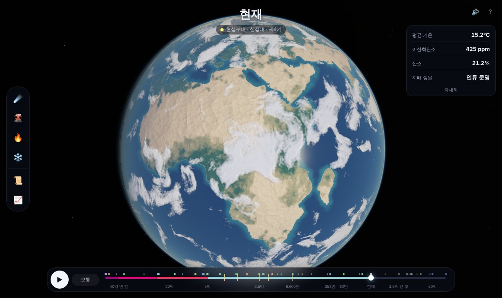
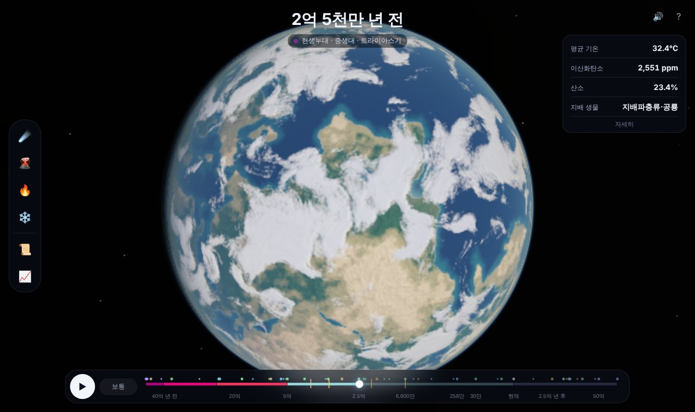
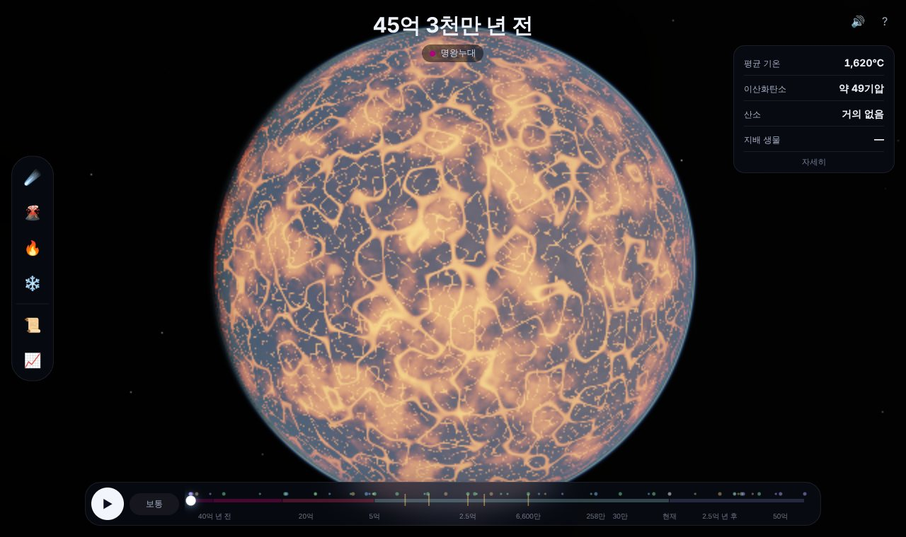
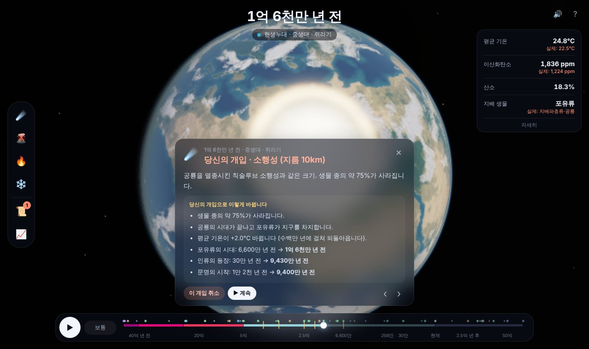
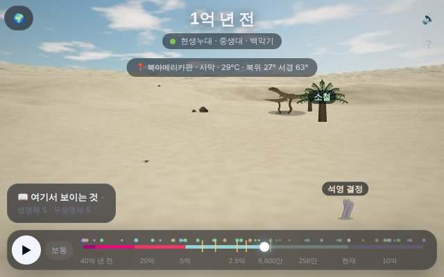
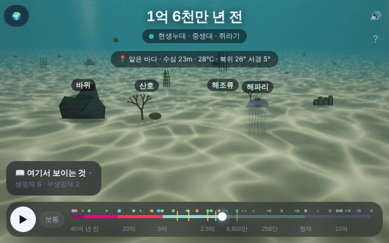
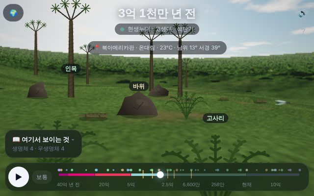
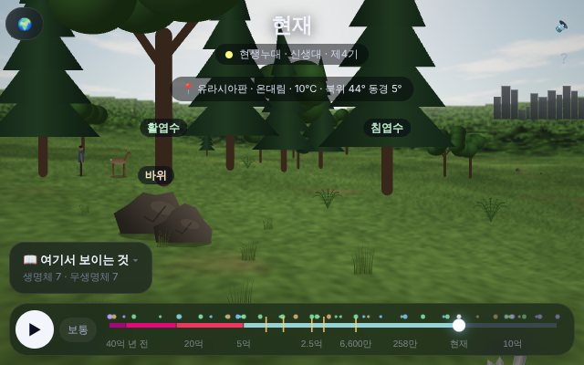

# 지구 연대기 (Earth Chronicle)

지구의 탄생(45억 4천만 년 전)부터 태양에 삼켜질 때(약 76억 년 뒤)까지, **지구의 시간을 직접 돌려 보고 역사를 바꿔 보는** 브라우저 시뮬레이션입니다.

설치도 빌드도 필요 없습니다. 지구, 구름, 대기, 달, 별은 모두 셰이더로 실시간 생성하고, 소리는 Web Audio로 합성합니다. 이미지 파일이 하나도 없습니다.

| 현재의 지구 | 판게아 (2억 5천만 년 전) |
|---|---|
|  |  |
| **마그마 바다 (45억 년 전)** | **역사에 개입: 1억 6천만 년 전 소행성 충돌** |
|  |  |

## 실행 방법

**가장 간단한 방법:** [`dist/earth-chronicle.html`](../dist/earth-chronicle.html) 파일 하나만 내려받아 브라우저로 여세요.
WebGL2를 지원하는 최신 Chrome, Edge, Firefox, Safari가 필요합니다. 휴대폰에서도 됩니다.

저장소를 받았다면 `earth/index.html` 을 바로 열어도 됩니다.

## 할 수 있는 것

### 시간 여행
- **▶ 재생**하면 시간이 흐르고, 중요한 사건에서 멈추며 설명이 나옵니다. 속도 버튼으로 빠르기를 바꿉니다.
- 아래 **타임라인을 끌면** 원하는 시대로 바로 갑니다. 타임라인의 점을 누르면 그 사건으로 갑니다.
  - 초록 점: 생명 · 파란 점: 기후 · 갈색 점: 지질 · 보라 점: 천문 · 노란 줄: 대멸종 · 주황 마름모: 당신의 개입
- **지구를 끌면** 돌아가고, 휠이나 두 손가락으로 확대합니다.

### 지구의 모습이 시대마다 바뀝니다
- 마그마 바다 → 달을 만든 거대 충돌 → 수증기 대기와 첫 바다 → 메탄 안개로 주황빛이던 시생누대 하늘
- 대산화 사건 뒤 붉게 녹슨 땅, 지구 전체가 얼어붙은 눈덩이 지구
- 초대륙 컬럼비아 · 로디니아 · 곤드와나 · 판게아가 모였다 흩어지는 판의 움직임
- 육상 식물이 퍼지며 초록으로 물드는 대륙, 빙하기마다 내려오는 얼음과 낮아지는 해수면, 밤에 빛나는 도시
- 먼 미래: 다음 초대륙, 밝아지는 태양, 사라지는 식물과 바다, 금성 같은 대기, 적색거성이 된 태양
- 달은 처음엔 지금보다 열 배 넘게 가까웠다가 점점 멀어지고, 하루는 5시간에서 24시간으로 길어집니다.

### 확대해서 땅으로 내려가기
- 지구를 확대할수록 해안선, 산맥, 강, 구름이 더 잘게 보입니다.
- 가까이 가면 화면 아래에 **⬇ 땅으로 내려가기** 버튼과 그 아래 지형(사막, 열대 우림, 얕은 바다…)이 나옵니다. 끝까지 확대해도 내려갑니다.
- 내려가면 **그 장소, 그 시대의 풍경** 속에 서게 됩니다. 끌어서 360° 둘러보고, 축소하거나 🌍 버튼을 누르면 우주로 돌아갑니다.
  - 하늘: 대기 산란으로 계산한 하늘색과 노을, 시대마다 크기가 다른 해와 달(45억 년 전 달은 지금보다 열 배 넘게 크게 보입니다), 별, 구름
  - 땅: 언덕과 먼 산, 사막의 모래 언덕, 해안과 파도, 빙원, 마그마 바다
  - 바다를 고르면 **바닷속**으로 들어가 물결 무늬 빛과 함께 바다 생물을 봅니다.
- 보이는 **생명체와 무생명체**를 누르면 설명이 나옵니다. 왼쪽 **📖 여기서 보이는 것** 목록에서 고르면 그쪽으로 고개를 돌립니다.

| 백악기 땅 위 | 쥐라기 바닷속 |
|---|---|
|  |  |
| **석탄기 숲** | **지금의 해안** |
|  |  |

| 시대 | 볼 수 있는 것 (예) |
|---|---|
| 명왕누대 | 마그마, 화산, 쏟아지는 유성 |
| 시생누대·원생누대 | 스트로마톨라이트, 미생물 매트, 해조류 |
| 에디아카라기 | 디킨소니아, 카르니아, 해파리 |
| 고생대 | 삼엽충, 아노말로카리스, 상어, 쿡소니아, 고사리, 인목 숲, 거대 잠자리, 초기 양서류, 디메트로돈 |
| 중생대 | 소철, 침엽수, 용각류, 수각류, 뿔공룡, 익룡, 새, 초기 포유류, 암모나이트, 수장룡 |
| 신생대 | 활엽수, 야자나무, 풀, 사슴, 매머드, 고래, 사람, 움집, 도시 |

생명체는 "진화 시계"를 따르므로, 역사를 바꾸면 나오는 생물도 달라집니다(예: 6600만 년 전 소행성을 막으면 지금도 공룡이 걸어 다닙니다).

### 역사에 개입하기
옆의 도구 버튼으로 지금 보고 있는 시점에 개입합니다.

| 도구 | 효과 |
|---|---|
| ☄️ 소행성 1km / 10km / 100km / 500km | 지역 재난 / 공룡 멸종급 / 동식물 전멸 / 바다가 끓어 모든 생명 소멸 |
| 🌋 화산 분출 | 시베리아 트랩 같은 대분출. 이산화탄소 4배, 지구 온난화와 멸종 |
| 🔥 온실가스 ×3 · ❄️ 온실가스 ÷3 | 수백만 년에 걸쳐 되돌아오는 기후 변화. 너무 추우면 눈덩이 지구가 됩니다 |

타임라인의 **노란 줄(5대 대멸종)** 을 누르면 그 사건을 **막을** 수도 있습니다.

몇 가지 해 볼 만한 것:
- 6600만 년 전 소행성을 막으면? → 공룡이 오늘날까지 지구를 지배하고, 인류는 나타나지 않습니다.
- 1억 6천만 년 전에 지름 10km 소행성을 떨어뜨리면? → 포유류의 시대가 일찍 와서 인류가 약 9430만 년 전에 나타납니다.
- 현재 지구에 지름 100km 소행성을 떨어뜨리면? → 복잡한 생명이 처음부터 다시 진화해야 하는데, 그 전에 태양이 너무 밝아집니다.
- 마지막 빙하기 한가운데 온실가스를 줄이면? → 지구 전체가 얼어붙었다가 수백만 년 뒤 녹습니다.

**📜 바뀐 역사**에서 실제 역사와 당신의 역사를 비교하고, 개입을 취소할 수 있습니다. **📈 그래프**는 기온·CO₂·산소·생물 다양성을 전체 시간에 걸쳐 보여 줍니다.
진행 상황은 브라우저에 자동 저장됩니다.

## 시뮬레이션은 이렇게 움직입니다

- **실제 역사가 기준입니다.** 지구 평균 기온, 대기 이산화탄소·산소, 달까지 거리, 하루 길이, 젊은 태양의 밝기(Gough 1981 식)는 연구로 복원한 값을 따릅니다.
- **대륙**은 판마다 회전(오일러 극)으로 움직입니다. 판게아·곤드와나 맞춤은 실제 복원 연구의 회전값(Bullard 외 1965 등)을 바탕으로 했고, 그보다 오래된 초대륙과 미래의 초대륙은 정확한 모양을 알 수 없어 현재 대륙을 빌려 그린 상상도입니다.
- **기후**: 이산화탄소가 바뀌면 기온이 `4°C × log₂(배수)` 만큼 변하고(지질학적 기후 민감도), 그 변화는 암석 풍화로 수백만 년에 걸쳐 되돌아옵니다. 기온이 너무 낮아지면 얼음-반사 되먹임으로 눈덩이 지구가 되고, 화산의 이산화탄소가 쌓여야 녹습니다.
- **생명**은 "진화 시계"로 다음 단계까지 남은 시간을 셉니다. 실제 역사에서는 시계 = 시간입니다.
  - 아주 큰 멸종은 시계를 되감습니다(동식물 전멸 → 다세포 생물부터 다시, 모든 생명 소멸 → 처음부터).
  - 큰 멸종(종의 60% 이상)이 빈자리를 만들어야 다음 무리가 지배합니다: 양서류·단궁류 → 지배파충류·공룡 → 포유류.
  - 인류는 포유류가 지배한 뒤 약 6570만 년이 지나야 나타납니다.
  - 너무 뜨겁거나 이산화탄소가 너무 적으면 복잡한 생명이 살 수 없습니다(미래에 태양이 밝아지며 일어나는 일).
- 같은 개입은 언제나 같은 결과를 냅니다(결정적 시뮬레이션).
- **지구 모습**: 대기는 레일리·미 산란을 직접 적분해 계산합니다(파란 테두리, 해 질 녘의 붉은 빛, 시생누대의 주황빛 연무). 구름은 그림자를 드리우고, 확대할수록 해안선·산·구름에 더 잘게 갈라진 무늬가 더해집니다.
- **지상 장면**: 화면의 그 지점을 컴퓨터가 셰이더와 똑같은 식으로 다시 계산해(바다인지, 해안까지 거리, 기온, 습도, 생물군계) 풍경과 등장 생물을 정합니다. 생물은 직접 그린 벡터 그림이며 걷고, 헤엄치고, 날고, 흔들립니다.

단순화한 모형이라 과학적 예측이 아니라 **"만약에"를 상상해 보는 도구**입니다. 먼 과거·미래의 수치일수록 불확실성이 큽니다.

## 프로젝트 구조

```
index.html            진입점 (스크립트 순서가 중요합니다)
css/style.css         화면 스타일 (데스크톱 + 휴대폰)
js/core/              공용 도우미(보간, 한국어 시간 표기), 쿼터니언, 셰이더와 같은 잡음 함수
js/data/              데이터: 지질 시대·타임라인 눈금, 해안선, 판 키프레임, 기후 기준값, 사건·도구
js/sim/plates.js      판의 움직임 계산
js/sim/model.js       기후·생명 시뮬레이션 (DOM 없음, Node 에서도 동작)
js/sim/surface.js     한 지점의 지표 정보와 생물군계 (셰이더와 같은 계산)
js/field/             지상 탐사: 지형·하늘 값(terrain), 생명체·무생명체 도감과 그림(species), 배치·움직임(scene), 모드 전환(mode)
js/render/            해안선 → 거리장 텍스처, 지구·지상 셰이더, WebGL 래퍼, 시대별 모습, 충돌 연출
js/ui/                소리, 상태 패널, 타임라인, 그래프, 사건 카드·바뀐 역사
js/main.js            시작점 (재생, 카메라, 개입, 저장)
tests/sim.test.js     시뮬레이션·데이터·판 운동 검사
tests/field.test.js   시대·장소별 등장 생물, 그림 함수, 지형 검사
tools/                개발용 도구 (판 지도 디버그, 렌더 테스트, 스크린샷)
```

## 한 파일로 만들기

저장소 맨 위에서:

```bash
node tools/build.js
```

`dist/card-expedition.html` 과 `dist/earth-chronicle.html` 이 함께 다시 만들어집니다.

## 테스트

```bash
node earth/tests/sim.test.js
```

```bash
node earth/tests/field.test.js
```

실제 역사의 이정표(생명 38억 년 전, 대산화 사건, 캄브리아기 대폭발, 공룡, 포유류, 인류 30만 년 전, 문명 1만 2천 년 전, 미래의 식물 위기와 마지막 생명)가 제때 일어나는지,
바뀐 역사(소행성을 막거나 떨어뜨리기, 눈덩이 지구, 온실가스)가 예상대로 갈라지는지, 판이 끊기지 않고 움직이는지, 한국어 시간 표기가 맞는지 검사합니다.

개발용 도구(Chromium + Playwright 필요):

```bash
node earth/tools/shot-platemap.js '{"times":[-250,-200,0]}' platemap.png
```

```bash
node earth/tools/shot-app.js 출력폴더 1280 800
```

`shot-platemap.js` 는 시점별 판 배치를 평면 지도로, `shot-app.js` 는 앱의 주요 장면을 찍습니다. 판 지도에서 노란색은 판이 겹친 곳입니다.

## 참고한 자료

- 지구 평균 기온: Scotese 외 (2021), Judd 외 (2024, *Science*)
- 젊은 태양의 밝기: Gough (1981)
- 달의 후퇴와 하루 길이: 조석 리듬층 연구 (Williams 2000 등)
- 대서양 맞춤 회전: Bullard, Everett & Smith (1965)
- 미래의 식물·바다·생명: Caldeira & Kasting (1992), O'Malley-James 외 (2013), Ozaki & Reinhard (2021)
- 지질 시대 경계와 색: 국제층서위원회(ICS) 연대표
