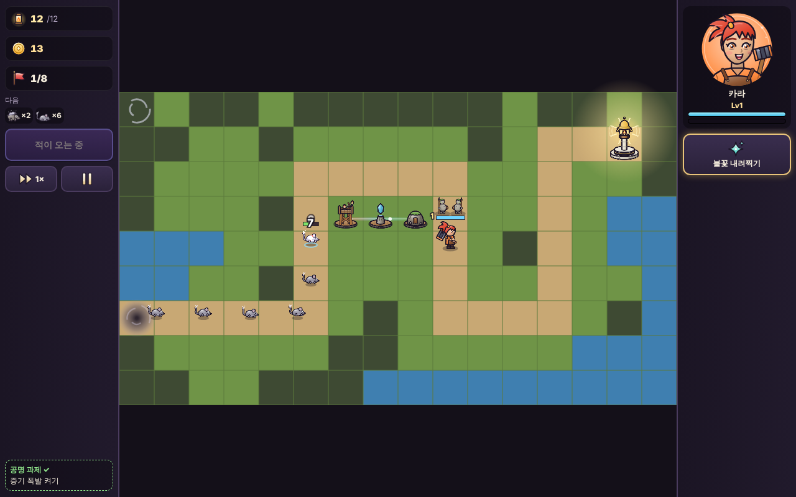
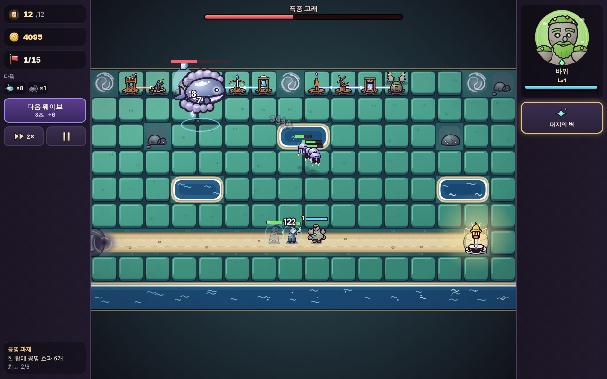

# 공명 수호대 (Resonance Guard)

여섯 원소의 탑을 서로 이웃하게 세워 **공명**을 일으키고, 영웅과 함께 잿빛 안개로부터 마을의 등불을 지키는 **판타지 타워 디펜스**입니다.

설치도, 빌드도, 인터넷도 필요 없습니다. 그림은 모두 코드로 그린 SVG이고, 효과음과 음악은 브라우저에서 실시간으로 합성합니다.

| 전투 (2지역 서리 고개) | 보스 6종 |
|---|---|
|  |  |

## 실행 방법

**가장 간단한 방법:** [`dist/resonance-guard.html`](dist/resonance-guard.html) 파일 하나만 내려받아 브라우저(Chrome, Edge, Firefox, Safari)로 여세요.

저장소를 받았다면 `index.html`을 열어도 됩니다. 휴대폰은 **가로 화면**으로 즐기세요.

## 플레이 방법

1. **월드 지도**에서 맵을 고르고, **출정 준비**에서 영웅을 고릅니다.
2. 전투가 시작되면 시간이 멈춘 준비 단계입니다. **빈 땅을 누르면** 탑 목록이 나오고, 탑을 고르면 사거리와 **공명 미리보기**가 보입니다. 한 번 더 누르면 지어집니다.
3. 준비가 되면 **전투 시작**(Space). 적이 울림등(등불)에 닿으면 불꽃이 꺼집니다. 불꽃 12개가 모두 꺼지면 패배.
4. 탑끼리 **이웃하게(대각선 포함)** 지으면 공명이 생깁니다. 원소 짝마다 효과가 다르고, 같은 효과는 한 번만 적용되니 **여러 원소를 섞을수록** 강해집니다.
5. 탑은 Lv3까지 강화하고, 첫 보스를 쓰러뜨린 뒤에는 **두 갈래 분기(Lv4)** 중 하나를 고를 수 있습니다.
6. 영웅을 누르고 땅을 누르면 그곳으로 걸어갑니다. 오른쪽 기술 버튼(Q)으로 영웅 기술을 씁니다.

### 별

| 조건 | 별 |
|---|---|
| 클리어 / 불꽃 6개 이상 / 불꽃 11개 이상 | ★1 / ★2 / ★3 |
| 그 맵의 **공명 과제** 달성 | ★+1 |
| 그 맵의 **도전** 클리어 | ★+1 |

모은 별로 **기술 나무**를 찍을 수 있습니다(언제든 무료 초기화).

### 조작

| 입력 | 동작 |
|---|---|
| 빈 칸 누르기 → 탑 고르기 → 한 번 더 | 건설 |
| 탑 누르기 | 정보·강화·분기·표적·판매 |
| 적 누르기(휴대폰은 길게) | 적 정보 |
| `Space` | 웨이브 호출 (일찍 부르면 보너스 골드) |
| `Q` / `H` | 영웅 기술 / 영웅 선택 |
| 방향키 → `Enter` → `1`~`9` → `Enter` | 키보드로 칸 고르기 → 탑 고르기 → 건설 |
| `U` / `S` / `1`·`2` | 선택한 탑 강화 / 판매 / 분기 A·B |
| `F` / `P` / `Esc` | 배속 / 일시정지(일시정지 중에도 건설 가능) / 취소 |

## 콘텐츠

- 지역 5곳, 캠페인 맵 30개 + 무한 맵 5개 (고정 길 · 길 만들기 · 혼합)
- 탑 18종 (6원소 × 3, 각 3단계 + 분기 2갈래 = 90가지 모습)
- 공명 효과 16가지
- 적 40종 + 보스 6종, 특성 18가지(비행·은신·보호막·굴착·부활·침묵·적응·공명 차단 …)
- 영웅 6명 (기술·패시브·대사·초상화 표정 3종)
- 이야기 17장면과 엔딩, 도감, 기술 나무 20칸, 도전 30개, 공명 과제 30개
- 음악 10곡, 효과음 51종

## 설계 문서

| 문서 | 내용 |
|---|---|
| [docs/DESIGN.md](docs/DESIGN.md) | 게임 설계서 (규칙의 기준, 엔진 규칙 부록 포함) |
| [docs/design/](docs/design/) | 탑·적·영웅·맵·이야기 설계서 (수치 표는 데이터에서 자동 생성) |
| [docs/ARCHITECTURE.md](docs/ARCHITECTURE.md) | 모듈 구조와 약속 |
| [docs/QUALITY.md](docs/QUALITY.md) | 품질 합격 기준 |
| [docs/PROGRESS.md](docs/PROGRESS.md) | 진행 기록과 결정 사항 |
| [docs/reports/](docs/reports/) | 밸런스·그림 검수·화면 검사 보고서 |

## 검사

```bash
node tests/run.js
```

```bash
node tools/balance.js --search
```

```bash
node tools/art-review.js
```

```bash
node tests/e2e/screens.js --dist
```

```bash
node tests/e2e/play.js --dist --map 1-1
```

```bash
node tests/e2e/flows.js --dist
```

- `tests/run.js`: 규칙 테스트(피해 계산·공명·제어 감쇠·은신·보스 등), 데이터 무결성, 설계서와 데이터 일치
- `tools/balance.js`: 무작위·그리디·탐색 봇으로 맵마다 여러 판을 돌려 `docs/reports/balance.md` 작성 (`--challenge`, `--tasks`, `--soak N`)
- `tools/art-review.js`: 모든 그림을 대상별 이미지로 찍기 (`docs/reports/art/`)
- `tests/e2e/screens.js`: 데스크톱·휴대폰 가로·세로 화면 캡처와 콘솔 오류 검사
- `tests/e2e/play.js`: 타이틀부터 결과까지 실제 화면 흐름으로 한 판 진행
- `tests/e2e/flows.js`: 키보드만으로 한 판, 터치만으로 한 판(휴대폰 가로), 판 도중 새로고침 → 이어하기

## 한 파일로 만들기

```bash
node tools/build.js
```

`dist/resonance-guard.html`이 다시 만들어집니다.
