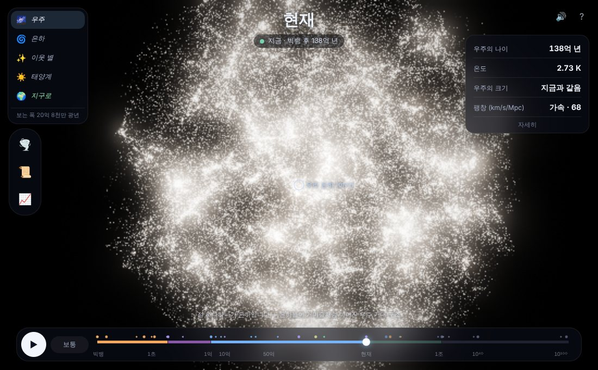
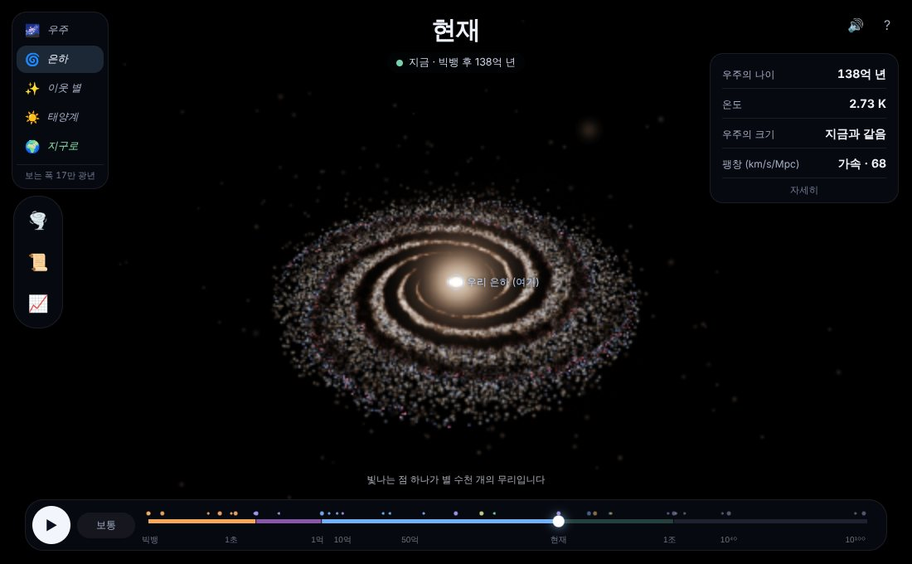
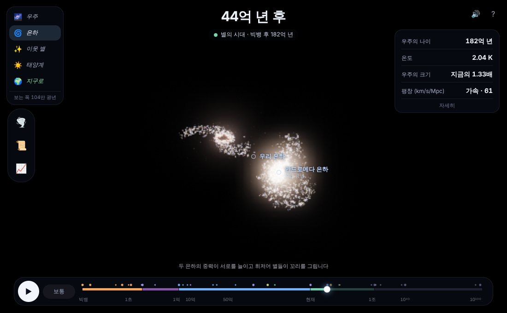
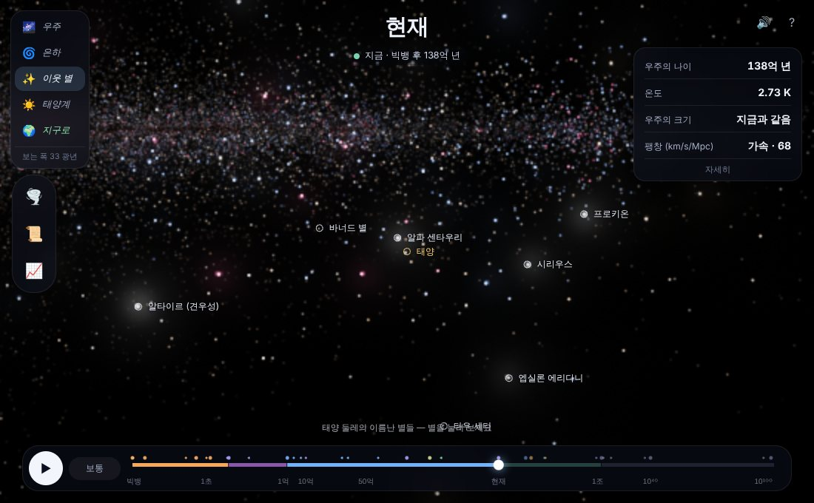
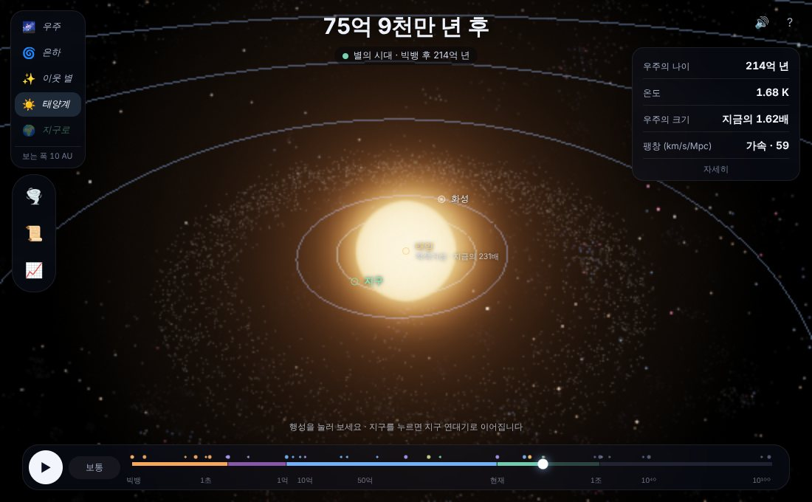
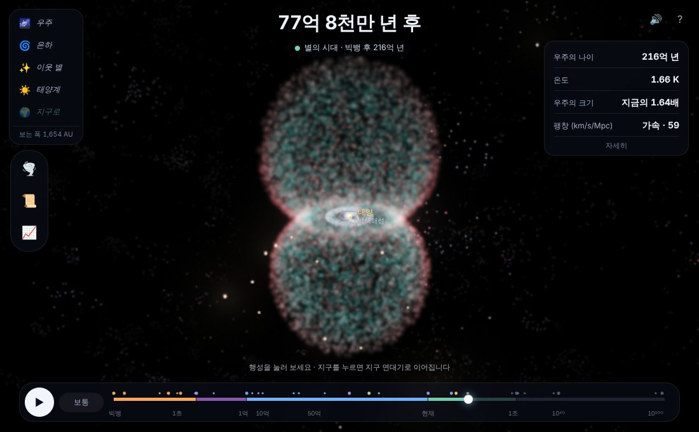

# 우주 연대기 (Cosmic Chronicle)

빅뱅 10⁻⁴³초 뒤부터 마지막 블랙홀이 사라지는 10¹⁰⁰년 뒤까지, **우주의 시간을 직접 돌려 보고 우주의 운명을 바꿔 보는** 브라우저 시뮬레이션입니다.

우주 전체에서 은하, 이웃 별, 태양계까지 한 번에 확대해 들어갈 수 있고, 태양계에서 지구를 누르면 [지구 연대기](../earth/README.md)로 그 시대의 지구에 내려갑니다.

설치도 빌드도 필요 없습니다. 별과 은하를 나타내는 입자 32만여 개를 모두 계산으로 만들어 셰이더로 그리고, 소리는 Web Audio로 합성합니다. 이미지 파일이 하나도 없습니다.

| 우주 거대 구조 (지금) | 우리 은하 |
|---|---|
|  |  |
| **45억 년 뒤: 안드로메다와 충돌** | **태양 둘레의 별과 은하수** |
|  |  |
| **76억 년 뒤: 적색거성이 된 태양** | **행성상 성운과 백색왜성** |
|  |  |

## 실행 방법

**가장 간단한 방법:** [`dist/universe-chronicle.html`](../dist/universe-chronicle.html) 파일 하나만 내려받아 브라우저로 여세요.
WebGL2를 지원하는 최신 Chrome, Edge, Firefox, Safari가 필요합니다. 휴대폰에서도 됩니다.
지구 연대기로 이어지려면 같은 폴더에 [`dist/earth-chronicle.html`](../dist/earth-chronicle.html)도 두세요.

저장소를 받았다면 `universe/index.html` 을 바로 열어도 됩니다.

## 할 수 있는 것

### 시간 여행
- **▶ 재생**하면 시간이 흐르고, 중요한 사건에서 멈추며 설명이 나옵니다. 사건에 맞는 범위로 카메라도 날아갑니다.
- 아래 **타임라인을 끌면** 원하는 시대로 갑니다. 10⁻⁴³초부터 10¹⁰⁶년까지를 로그·선형 눈금을 섞어 한 줄에 담았습니다.
  - 주황 점: 초기 우주의 물리 · 보라 점: 우주 · 파란 점: 은하 · 노란 점: 별 · 초록 점: 지구 · 빨간 마름모: 당신의 개입
- 태양이 있던 최근 50억 년은 지구 연대기처럼 "몇 년 전"으로, 그보다 이른 때는 "빅뱅 후"로 시계를 보여 줍니다.

### 우주 → 은하 → 이웃 별 → 태양계로 확대
- **휠이나 두 손가락**으로 10⁻⁵광년(태양계 안쪽)부터 10¹⁰광년(우주 거대 구조)까지 끊김 없이 확대·축소합니다. 왼쪽 위 버튼을 누르면 그 범위로 날아갑니다.
- **끌어서** 돌려 보고, 천체를 **누르면** 설명이 나옵니다. 태양계에서 **지구**를 누르면 지구 연대기로 이어집니다(반대로 지구 연대기의 🌌 버튼은 우주 연대기로 돌아옵니다).

| 범위 | 볼 수 있는 것 |
|---|---|
| 🌌 우주 | 은하들이 거미줄처럼 이어진 우주 거대 구조. 빅뱅 직후엔 고르게 퍼져 있던 물질이 필라멘트와 은하단으로 모이고, 첫 별은 붐비는 곳부터 켜집니다 |
| 🌀 은하 | 우리 은하와 안드로메다. 작은 덩어리들이 모여 두꺼운 원반 → 얇은 원반과 나선팔 → 충돌 → 타원 은하가 됩니다 |
| ✨ 이웃 별 | 알파 센타우리, 시리우스, 베가, 베텔게우스 등 이름난 별 17개(실제 위치)와, 안에서 본 은하수 |
| ☀️ 태양계 | 태양과 행성들. 원시 구름 → 원시 행성 원반 → 지금의 태양계 → 적색거성 → 행성상 성운 → 백색왜성 |

### 시대마다 바뀌는 우주
- **빅뱅과 급팽창**: 한 점에서 화면을 가득 채우는 불덩이
- **뜨거운 플라스마**: 온도에 따라 보랏빛 흰색 → 노랑 → 주황으로 식어 가는, 빛조차 갇힌 우주
- **우주가 투명해짐(38만 년)**: 주황빛 우주 배경 복사가 붉어지다 사라지고 캄캄한 **암흑 시대**로
- **첫 별(1~2억 년)**, 별 탄생의 전성기, 은하의 성장, 가속 팽창
- **먼 미래**: 이웃 은하가 우주 지평선 너머로 사라지고, 별이 붉어지다 꺼지고(100조 년), 별의 잔해만 가끔 번쩍이는 축퇴 시대, 블랙홀 시대, 마지막 블랙홀의 증발(10¹⁰⁰년), 열죽음

### 우주의 운명 바꾸기
왼쪽 🌪️ 버튼으로 **지금 보고 있는 순간부터** 암흑 에너지를 바꿉니다.

| 선택 | 결과 |
|---|---|
| 🌪️ 키우기 (빅 립) | 팽창할수록 강해지는 "유령 에너지"(w = −1.5). 지금 바꾸면 225억 년 뒤 우주가 찢어집니다. 은하는 끝나기 7천만 년 전, 태양계는 3개월 전, 원자는 10⁻¹⁹초 전에 찢어집니다 |
| 🧲 뒤집기 (빅 크런치) | 암흑 에너지가 끌어당기는 힘이 됩니다. 팽창이 멈추고, 은하들이 다가오고, 우주가 다시 뜨거워져 한 점으로 무너집니다 |
| ♻️ 원래대로 | 지금의 우주 상수로 되돌립니다. 이미 쪼그라들기 시작한 우주는 되돌릴 수 없습니다 |

**📜 바뀐 역사**에서 실제 우주와 당신의 우주를 비교하고 개입을 취소할 수 있습니다. **📈 그래프**는 우주의 크기·온도·팽창 속도를 전체 시간에 걸쳐 보여 줍니다.

## 이렇게 계산합니다

- **우주의 팽창**: 프리드만 방정식 H² = H₀²(Ωr a⁻⁴ + Ωm a⁻³ + ρ암흑에너지)를 룽게-쿠타법으로 풉니다. 값은 플랑크 위성 관측(H₀ = 67.7 km/s/Mpc, Ωm = 0.31)을 따랐고, 우주의 나이 137.9억 년, 투명해진 때 37만 년, 관측 가능한 우주의 반지름 462억 광년, 가속 팽창 시작 61억 년 전이 이 계산에서 나옵니다.
- **우주 거대 구조**: 64³ 격자에 가우스 무작위장(급팽창의 양자 요동)을 만들고 3차원 FFT로 변위장을 구해, 젤도비치 근사 x = q + D(t)ψ(q)로 은하 15만 7천 개를 움직입니다. 구조 성장 인자 D(t)는 같은 우주론 모형으로 풉니다.
- **은하 충돌**: 두 은하를 별 원반 + 암흑 물질 헤일로(플러머 퍼텐셜)로 두고 서로의 중력과 동역학적 마찰로 다가가게 했습니다. 별 6,800개를 립프로그법으로 직접 움직이고(2.5백만 년 간격, 2억 년마다 저장), 화면의 나머지 별들은 가장 가까운 계산 별을 따라갑니다. 첫 충돌은 약 42억 년 뒤, 합쳐지는 것은 약 60~65억 년 뒤이고, 태양은 바깥쪽으로 밀려납니다.
- **태양의 일생**: 표준 항성 진화 모형(Sackmann 1993, Schröder & Smith 2008)의 반지름·밝기·온도·질량을 간추렸습니다. 태양이 질량을 잃으면 행성 궤도가 넓어지고(a ∝ 1/M), 부푼 태양에 닿은 수성·금성·지구는 삼켜집니다.
- **방향**: 태양계는 황도면이 은하면과 60° 기울어진 실제 방향으로, 이웃 별은 적경·적위·거리를 은하 좌표로 바꿔 놓았습니다.
- **그리기**: 별 하나하나를 가우스 모양의 빛으로 HDR 버퍼에 더하고(빛은 거리의 제곱에 반비례), 블룸과 톤 매핑을 거쳐 보여 줍니다. 층마다 원점과 단위를 따로 두고 카메라 기준 위치를 64비트로 계산해, 15자릿수가 넘는 확대에서도 떨리지 않습니다.

은하와 별의 모습은 사진이 아니라 계산으로 그린 것이고, 단순화한 모형이라 **"만약에"를 상상해 보는 도구**로 즐겨 주세요. 아주 먼 미래(양성자 붕괴, 블랙홀 증발 등)는 지금 아는 물리학으로 본 예측입니다.

## 프로젝트 구조

```
index.html            진입점 (스크립트 순서가 중요합니다)
css/style.css         화면 스타일 (지구 연대기와 같은 모양, 데스크톱 + 휴대폰)
js/core/util.js       보간, 난수, 흑체 색, 10⁻⁴³초부터 10¹⁰⁰년까지 한국어로 쓰기
js/sim/cosmo.js       프리드만 방정식 (팽창·온도·성장 인자·지평선, 빅 립·빅 크런치)
js/data/              시간 눈금과 시대 이름(epochs), 사건(events), 이웃 별(stars)
js/sim/history.js     개입과 갈라진 역사, 우주의 끝 사건
js/sim/web.js         우주 거대 구조 (가우스 무작위장, FFT, 젤도비치 근사)
js/sim/galaxy.js      우리 은하·안드로메다 입자, 형성 과정, 충돌 N체 계산
js/sim/solar.js       태양의 일생, 행성, 좌표 변환(황도·적도·은하)
js/render/            WebGL 도우미, 셰이더, 렌더러(HDR·블룸), 장면 계산(카메라·층·시대별 모습)
js/ui/                소리, 상태 패널, 타임라인, 그래프, 카드·바뀐 역사
js/main.js            시작점 (재생, 카메라, 이름표, 개입, 저장, 지구 연대기 연결)
tests/universe.test.js 우주론·눈금·사건·개입·거대 구조·충돌·태양계·장면 계산 검사
tools/                개발용 스크린샷: 장면(shot), 조작 흐름(shot-flow), 휴대폰·지구 연결(shot-links)
```

## 한 파일로 만들기 · 테스트

저장소 맨 위에서:

```bash
node tools/build.js
```

```bash
node universe/tests/universe.test.js
```

우주의 나이·온도·허블 상수·지평선이 관측값과 맞는지, 빅 립·빅 크런치가 제때 끝나는지, 타임라인 눈금이 끊기지 않는지, 은하 충돌이 예측한 때 일어나는지, 태양이 행성을 차례로 삼키는지, 어느 시대·어느 확대에서도 장면 계산이 되는지 검사합니다.

개발용 스크린샷:

```bash
node universe/tools/shot.js 출력폴더 1100 680
```

## 참고한 자료

- 우주론 값: Planck Collaboration (2018) VI
- 우주 배경 복사와 재결합, 빅뱅 핵합성: 표준 우주론 교과서 (Ryden, *Introduction to Cosmology*)
- 젤도비치 근사: Zel'dovich (1970)
- 빅 립과 묶인 계가 찢어지는 때: Caldwell, Kamionkowski & Weinberg (2003)
- 안드로메다 충돌: van der Marel 외 (2012, 2019), Sawala 외 (2025, *Nature Astronomy*)
- 태양의 미래: Sackmann, Boothroyd & Kraemer (1993), Schröder & Smith (2008)
- 먼 미래: Adams & Laughlin (1997), Krauss & Scherrer (2007)
- 가장 먼 은하: Carniani 외 (2024, JADES-GS-z14-0)
